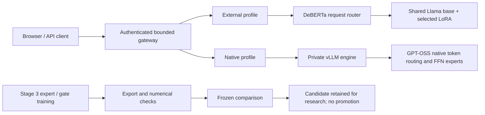

# MoE Routing and Adaptation

An ML systems study of request-level specialist routing and adaptation of native
Mixture-of-Experts models: training, checkpoint recovery, portable exports,
controlled evaluation, and authenticated serving.

**Research release.** The native expert update reduced development loss but did
not improve held-out math/science proxies. It was not promoted. Known quality
failures and pending independent review are documented rather than hidden.

| Component | Implemented and verified | Limitation |
|---|---|---|
| Stage 1: external routing | DeBERTa selects named LoRA specialists on a shared Llama-3.1-8B-Instruct base | Historical headline router accuracy had split overlap |
| Stage 2: native MoE | GPT-OSS-20B attention adaptation, calibrated export, authenticated serving and recovery | Answer-quality gates failed |
| Stage 3: native experts/gates | Resumable FFN/gate pilots, export calibration, 1,500 frozen comparison outputs | Single seed, short pilots; no held-out proxy improvement |

## Architecture



The external system selects one adapter per request. The native model routes
tokens inside its transformer; the gateway's task mode is an instruction, not
an external selector of individual native experts.

## Results

All three arms generated 500 identity-checked, nonempty outputs. The matched
parent and candidate used identical input-token hashes on all 500 cases.

| Arm | Math numeric proxy /200 | Science phrase proxy /100 | Truncated /500 |
|---|---:|---:|---:|
| Stage 2 parent, baseline 256 | 169 | 70 | 117 |
| Stage 2 parent, precision 512 | 171 | 69 | 39 |
| Stage 3 candidate, precision 512 | 165 | 64 | 36 |

These are automatic proxies, not independently reviewed accuracy. Baseline to
precision changes both instructions and token budget. The matched Stage 3
comparison changes model weights while holding inputs and decoding settings fixed.

The selected Stage 3 export reduced 80-row development NLL by **15.3%**. The
held-out result supports rejecting promotion despite that development gain.
The Stage 2 service previously handled **10,072 requests over two hours** with
p95 completion latency **2.898 seconds** under its recorded test workload.
This is not a claim of 10,072 simultaneous users or permanent live hosting.

Read the [results report](docs/RESULTS.md), [technical case study](docs/CASE_STUDY.md),
[system card](docs/SYSTEM_CARD.md), and [machine-readable results](reports/results.json).
The full 69-page report (pipeline, system design, 12 flowcharts, results, issues and source inventory) is available as a [PDF](reports/comprehensive-20261022/COMPREHENSIVE_PROJECT_REPORT.pdf)
and [standalone HTML](reports/comprehensive-20261022/COMPREHENSIVE_PROJECT_REPORT.html).


## Try the CPU UI/API demo

This is explicitly simulated: no weights are loaded and no model inference occurs.
Use Python 3.10–3.12 in a fresh virtual environment:

```bash
python -m venv .venv
source .venv/bin/activate
python -m pip install -r requirements-cpu-demo.lock
python -m pip install -e '.[dev]'
python scripts/demo_cpu.py
```

Open `http://127.0.0.1:8510` and enter `demo-local-only` in Access settings.
Every generated response is labelled simulated. This fixed demonstration token
is not a deployment credential. The server binds only to loopback.

```bash
curl http://127.0.0.1:8510/demo-status
curl -H 'Authorization: Bearer demo-local-only' \
  -H 'Content-Type: application/json' \
  -d '{"prompt":"Hello","expert":"GENERAL"}' http://127.0.0.1:8510/chat
python -m pytest -q tests/test_api.py tests/test_cpu_demo.py tests/test_data.py
```

## Real GPU inference and reproduction

Real inference requires separately obtained compatible weights and a supported
NVIDIA environment. No model weights, private datasets or credentials are bundled.
Read [reproduction](docs/REPRODUCIBILITY.md) and [deployment](docs/DEPLOYMENT.md).
The Stage 3 research export is not serving-qualified and is not the demo default.

## Repository layout

```text
src/moe_router/      maintained authenticated API and inference backends
src/internal_moe/    small reference MoE experiment
web/                same-origin browser interface
training/           dataset preparation, training, checkpoint/resume
evaluation/         evaluation, export and operational verification
scripts/            packaging, CPU demo, model and cluster utilities
configs/            model manifests and experiment configuration
tests/              CPU tests and optional framework/data-dependent checks
docs/               public reports, system card and runbooks
reports/            aggregate evidence and source provenance
deploy/             optional container configuration, not a verified deployment
```

Cluster utilities preserve experiment logic but are environment-specific;
site paths/node names are replaced with templates in this public source export.
The CPU quick start is the portable entry point. See the reproduction guide
for the distinction between source reproducibility and rerunning GPU research.

## Release status and limitations

- Model experimentation is frozen; existing evidence is preserved.
- Independent human answer/intent review is pending.
- General, support and benign-sensitive quality gates remain failed.
- Neither production safety nor clinical suitability is established.
- ICE deployment is restricted, temporary and allocation-dependent. Check
  [deployment status](reports/deployment.json); there is no permanent public URL.
- Code is MIT licensed. Model and dataset terms are separate; see
  [third-party materials](docs/THIRD_PARTY.md).

The [release checklist](docs/RELEASE_CHECKLIST.md) separates verified work from
pending publication, review, recording and deployment tasks.
