# MoE Routing and Adaptation: Comprehensive Project Report

**Recovery, data engineering, model adaptation, numerical export, evaluation, serving, and release**

Report date: October 22, 2026 · Author/project owner: Ramanathan Swaminathan.
This report consolidates verified project records and source inspection. AI-assisted
analysis and existing AI answer assessments are identified as such. It is not an
independent human evaluation, a claim of production readiness, or a claim that
pretrained foundation models and recovered adapters were trained from scratch.

**Current decision:** experiments are complete and frozen; Stage 3 is not promoted.
Answer-quality acceptance and production acceptance remain **false**. Independent
human review is pending. The most recent restricted demo ran successfully through
API/browser checks, missed its whole cold-start target, and is now stopped.

[TOC]

## 1. Executive summary

The project investigates two meanings of Mixture-of-Experts within a working
application. The external design uses a DeBERTa classifier to select a named
LoRA specialist on one shared Llama-3.1-8B-Instruct base. The native design uses
GPT-OSS-20B, whose transformer performs sparse token-level expert routing
internally. These designs share an application surface but have different
training, concurrency, formatting and deployment requirements.

The work progressed through recovery of an incomplete external project, repair
of model-selection and serving defects, a safety/support extension, native model
qualification, attention adaptation, numerical export and operational testing,
and finally bounded updates to actual native FFN experts and gates. It includes
data provenance, split isolation, resumable optimizer state, immutable artifacts,
controlled evaluation, protected API access, browser verification, cancellation,
bounded queues, model recovery, storage remediation and source packaging.

The implementation outcome and quality outcome differ. Stage 2 completed a
1,489-step attention-adaptation epoch over 23,814 eligible examples. Its selected
checkpoint-300 update, calibrated to strength 0.125, passed export and a complete
operating qualification. Its answer assessment still failed General, support and
benign-sensitive overrefusal gates. Stage 3 completed two 200-step FFN adaptation
pilots. A fixed calibration selected a numerically qualified joint-gate scale-0.5
export with a 15.3% development NLL reduction. On the reserved matched comparison,
that export lost six math numeric matches and five science phrase matches against
its parent. It therefore did not earn promotion.

The latest held-out collection contains 1,500 verified answers: 500 prompts in
three arms. All 500 paired parent/candidate input-token hashes match. This verifies
the comparison inputs and collection, not independent answer correctness. Earlier
Stage 2 review covers 526 answers using attributed, unblinded AI assessments,
including 89 exact reuses. Independent human scoring and prompt-intent adjudication
remain incomplete. No safety or clinical certification is implied.

The latest release-demo allocation, job 6479705, completed authenticated real
generation, operating probes and desktop/mobile browser checks. Its archive-to-ready
measurement was **646.49 seconds**, exceeding the unchanged **600-second** target.
Slurm exit zero did not turn that failed gate into a pass. The service stopped at
the allocation signal. No current model-backed endpoint is running in the verified
project queue. A local source release candidate and reports are prepared; public
repository creation/remote CI and the narrated walkthrough remain outstanding.

## 2. Scope, research questions and contributions

### 2.1 Questions addressed

1. Can the recovered external artifacts be preserved and made to serve the
   intended specialist rather than an incorrectly mapped or concurrently switched adapter?
2. Can published-data safety/support extensions be integrated while keeping
   protected tests and source-label limitations visible?
3. Can a pretrained native MoE be adapted and exported into a standard,
   recoverable serving artifact without changing its architecture?
4. Can actual expert FFN and gate parameters be updated with resumable training,
   preserving native operator behavior and export qualification?
5. Does a lower-loss selected expert/gate update improve held-out outputs over
   the exact same-input parent?
6. Can the resulting application enforce bounded work, authenticated access,
   request cleanup and verified recovery under finite GPU allocations?

### 2.2 Implemented contributions and attribution boundaries

The engineering contribution is the maintained runtime, artifact validation and
recovery work, governed data pipeline, adaptation/qualification tools, evaluation
infrastructure and operating evidence. The bases are pretrained upstream models.
Earlier domain adapters were recovered and preserved; their original full training
cannot be inferred from surviving notebooks. New native adaptation and the
safety-extension experiments have their own recorded recipes and provenance.

The small `src/internal_moe/` implementation is a reference architecture experiment
with sparse FFN routing. It is not a converted Llama checkpoint and is not the
production application. Native GPT-OSS adaptation also does not invent a new
transformer architecture. Request modes such as MATH are instructions, not names
of native expert IDs.

### 2.3 Scope frozen for release

The user stopped model experimentation on October 22. No additional training,
calibration sweep, model selection or held-out-driven tuning is authorized by
this report. Documentation, analysis of saved artifacts, packaging and release
verification remain in scope. Known failures are reported, not hidden through a
new metric, changed denominator or stronger claim.

## 3. What is complete, failed and pending

| Workstream | Verified status | Meaning and practical limit |
|---|---|---|
| External preservation | Complete: 17 weight files and original source ZIP verified | Integrity/preservation, not new expert-training provenance |
| External safety extension | Training, routing evaluation, real integration and 500-answer comparison complete | Routing acceptance failed; independent answer/policy review pending |
| Stage 2 data/training | Complete: 23,814 eligible examples, 1,489 steps | Best checkpoint selected before calibrated export |
| Stage 2 export | Qualified research artifact, archive independently restored | Numerical probes do not establish answer quality |
| Stage 2 earlier operations | Full job 6403909 passed cold start, soak, restart and rollback | Historical exact-profile workload, not permanent uptime |
| Stage 2 answer assessment | 526 attributed AI assessments complete | General/support/overrefusal gates failed; not independent human review |
| Stage 3 pilots | Both 200-step variants complete; real updates verified | One seed and short training budget |
| Stage 3 calibrated export | Selected joint-gate 0.5 passes original gates | Five probes and 80 development rows; another engine unqualified |
| Final three-arm collection | 1,500 answers verified; paired 500 input hashes match | Automatic proxies complete; independent quality/intent review pending |
| Latest demo 6479705 | API/operations/browser passed; now stopped | 646.49-second cold start failed 600-second gate |
| Source release checks | 136 passed/5 skipped; seven fresh-clone quick checks passed | Local checks, not remote CI or full artifact access |
| Public repository / recording | Local release candidate exists; remote publication and narrated video pending | GitHub SSH works; repository creation access remains a dependency |

The answer to “is all evaluation done?” is therefore **no**. Planned frozen model
generation and bounded numerical/proxy experiments are done. Independent human
assessment is not done; quality acceptance has failed; the latest cold-start
gate failed; exact Stage 3 serving qualification remains unperformed. These are
different states and must not be combined into a single green completion label.

## 4. Full project lifecycle

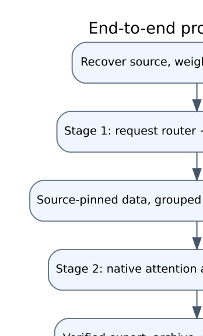

The workflow begins with the actual surviving source and weights rather than
training a replacement immediately. Recovery establishes label mappings, base
compatibility and artifact identity. Data preparation then produces versioned
inputs with controlled split membership. Training runs consume those inputs with
resumable state. Validation determines eligible checkpoints; export qualification
determines whether they are numerically portable. Serving qualification determines
whether the application operates correctly. Answer review remains a separate gate.

The final Stage 3 follow-up freezes its development-selected candidate before
held-out collection. A failed candidate attempt is recovered without repeating
the parent or retuning the candidate. Reports bind conclusions to the resulting
artifacts. Release packaging excludes bulk weights, private data and credentials.

This sequencing prevents a common conceptual error: treating optimization loss,
successful serialization, a healthy HTTP process and a useful answer as the same
success condition. The project contains evidence for each layer independently.

## 5. System design and trust boundaries

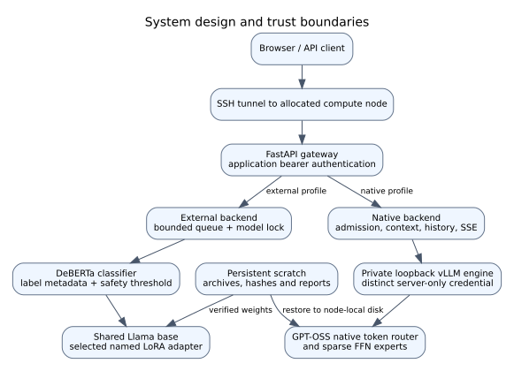

### 5.1 Component responsibilities

| Component | Responsibility | Important boundary |
|---|---|---|
| Browser `web/` | Profile/task controls, token entry, history, SSE display and cancellation | Credentials remain in tab memory; UI labels research limitations |
| FastAPI `api.py` | Request schemas, authentication, admission integration, responses and static UI | API workers must not duplicate or race mutable model state |
| External `backend.py` | Router inference, named adapter selection, protected generation | One shared base; exclusive selection/generation lock |
| Native `backends/internal_vllm.py` | Private engine client, bounded concurrency, cancellation, stream processing | Distinct server-only engine token; loopback URL required |
| Formatting/history modules | Token budget, task policy, final channel, complete-turn trimming | Client cannot supply an arbitrary system-role history entry |
| vLLM engine | Native model execution and GPU scheduling | Not directly exposed to the browser or public network |
| Training/export tools | Identity-bound model updates and verified artifact production | Separate from active serving and preserved originals |
| Audit/result storage | Raw evidence, manifests, checkpoint identity and decisions | Successful scheduler status never substitutes for artifacts |

### 5.2 Profile selection and residency

The verified single-GPU operating path runs one model profile at a time. A
native-to-external rollback stops native processes before loading the external
bundle. This avoids implying simultaneous GPU residency without capacity tests.
The API lists profile availability honestly; the custom future profile is not
accepted merely because it appears in a selector or schema.

The external system chooses a specialist once per request. The native system
routes intermediate token representations repeatedly inside transformer layers.
Native task instructions can shape a response but do not bypass native routing
or guarantee a particular latent expert's specialization.

### 5.3 Authentication and network exposure

The application uses bearer authentication. The native engine has a different,
owner-readable credential and must use a loopback HTTP URL without embedded URL
credentials. Engine paths including health, metrics, model listing and API/docs
paths are checked for unauthorized access. Readiness verifies the exact served
release, not merely an open TCP port.

The deployed research path uses SSH tunnelling into a finite ICE allocation.
There is no verified permanent public GPU endpoint and no paid cloud provisioning.
Access controls reduce exposure; they do not correct an unsafe or inaccurate answer.

## 6. Stage 1: artifact recovery and external expert routing

### 6.1 Initial recovery state

The surviving handoff was incomplete: source notebooks and training references
did not supply a runnable, self-contained application. Matching Instruct base
weights were absent from the recovered project. Some old environments were gone.
A large router safetensors file was truncated, while per-tensor chunks survived.
The original base/router/adapters required explicit provenance and compatibility
checks before any inference claim.

Recovery inventories distinguished structural checks from actual loading. A
safetensors header matching file length is not a numerical-integrity proof; a
symlink is not a backup. Large-router reconstruction required the complete
expected chunk set and strict tensor matching, rather than loading a known
truncated monolithic file. Matching base revision and tokenizer were restored
instead of silently substituting a non-Instruct cache.

Seventeen frozen external weight files and the original source archive were
later re-read and verified against the preservation manifest. Original weights
were retained. Research/recovery snapshots remain separate from maintained runtime
code and from the public source-only package. [E01, E02]

### 6.2 Correcting expert identity and concurrency

The recovered server's numerical router-label mapping disagreed with the
adapter actually selected. One audited checkpoint used MATH/SCIENCE/GENERAL,
while older checkpoints used another order. The repair reads checkpoint-specific
semantic metadata and validates it; there is no universal numerical label order.

Repeatedly wrapping the same mutable base in different PEFT objects was also an
unsafe basis for concurrent selection. The maintained implementation loads named
adapters once, selects the intended name and verifies the active adapter. A
bounded slot mechanism limits admitted work and a model lock covers routing,
adapter selection and generation. Finally blocks release both lock and slot on
success and failure. Multiple web workers are not a valid free throughput
optimization because they can duplicate GPU state or bypass that guarantee.

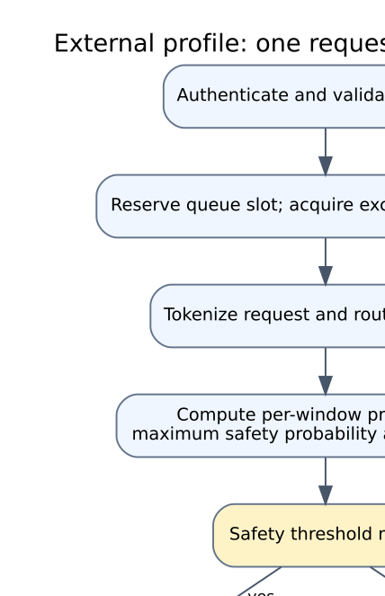

### 6.3 Tokenization and output correctness

Generation uses the matching chat template and decodes only newly generated
tokens. Inputs are checked against token limits; deterministic generation uses
`do_sample=False`. Router probabilities indicate classifier confidence, not
answer correctness. Manual selections are labelled separately and do not present
automatic confidence as if the classifier chose the route.

The combined adapter is a preserved comparison baseline, not an additional
ordinary router category or an undocumented automatic fallback. Base-only and
combined-adapter evaluations are explicit conditions. The public CPU demo is a
service double with labelled responses, not a small or quantized real model.

### 6.4 Historical external measurements

The historical 98.04% routing score used a split with shared questions. It is
retained as historical evidence but excluded from independent generalization
claims. A later 30-question authored sanity set produced 28/30 for an earlier
router, 25/30 for a newer base router and 27/30 for the recovered large router;
that small set participated in development selection, so it is not a final test.

On a separately assessed old native-comparison cohort, the external profile had
131/200 clearly correct math answers with seven uncertain, and 78/100 clearly
correct science answers with four uncertain. These were attributed AI judgments,
not human evaluation. They must not be mixed with a different automatic extractor
or the final confirmatory suite to manufacture an improvement trajectory.

## 7. External safety and support extension

### 7.1 Purpose and data semantics

A fourth SAFETY adapter and retrained router extend routing beyond ordinary
domains. The intended behaviors include declining harmful facilitation and
responding usefully to supportive requests. Those intents are not identical to
a source's toxicity flag, unsafe-response rating or broad interaction category.
The pipeline therefore records annotation provenance and preserves uncertainty.

The earlier three-domain adapters are recovered specialist artifacts, not newly
trained foundation models. Their training provenance is limited by surviving
configuration/notebook evidence. The SAFETY extension has a separately recorded
recipe and must not be conflated with the later native Stage 3 gate experiment.

The first router experiments failed declared 95% recall / 5% false-positive
targets. A larger model did not resolve the tradeoff. Initial protected tests
showed roughly 89% safety recall but materially worse benign-sensitive behavior
than an overall FPR could reveal. A positive-only external benchmark cannot
estimate FPR at all; its missing negative denominator is not a zero error rate.

| Earlier four-way router | Protected recall | Protected overall FPR | Protected benign-sensitive FPR | Positive-only external recall |
|---|---:|---:|---:|---:|
| Base DeBERTa candidate | 89.48% | 4.34% | 15.75% | 48.56% |
| Recovered large DeBERTa candidate | 88.59% | 4.31% | 15.40% | 48.03% |

These historical results use the 4,232-prompt protected cohort and 939-prompt
external cohort. The large candidate's validation tradeoff also failed: its best
operating point within 5% FPR reached 93.02% recall; reaching 95% recall required
at least 7.36% FPR. Selecting an attractive protected-test threshold afterward
would not be valid recovery. Historical routing measures remain separate from
the v3 table below. [E40]

### 7.2 Data expansion and recipe

The v2 corpus uses published participant-rated ESConv support conversations and
human-annotated ToxicChat prompts alongside existing data. Only qualifying
support responses with recorded feedback/strategy criteria are admitted; those
filters are not clinical validation. Machine-only toxicity annotations are
excluded. Non-toxic prompts are not automatically relabelled benign under a
broader support/medical routing policy. Conversations remain grouped in one split.

| Split | Router prompts | SAFETY labels | Unique SFT pairs | Human ESConv SFT pairs before context filtering |
|---|---:|---:|---:|---:|
| Train | 42,110 | 12,229 | 11,787 | 1,415 |
| Validation | 3,642 | 747 | 1,385 | 178 |
| Test | 4,633 | 1,409 | 1,463 | 174 |

The router continues with overlapping 384-token windows, two epochs, learning
rate 1e-5 and eight prompts per batch. Whole training prompts exceeding eight
windows are excluded rather than retaining a misleading truncated label.
Evaluation covers all windows. The safety probability threshold controls route
selection; the former top-class fallback cannot bypass it.

SAFETY LoRA continuation uses rank 16/alpha 32, one epoch, learning rate 5e-5,
1,024-token whole-example filtering and batch four/accumulation four. Support
pairs repeat three times in training only; unique-pair counts are reported
separately. The saved ledger records 11,725 retained unique training pairs,
1,353 retained human support pairs and 14,431 training presentations including
repeat. Existing domain adapters and base weights remain unchanged. [E03]

### 7.3 Failures, corrective v3 and results

Earlier SAFETY QLoRA used rank 16/alpha 32 with 41,943,040 trainable adapter
parameters and one epoch on 10,292 context-eligible pairs. Its validation loss
fell from 2.149 to 1.497 at selected checkpoint 600 of 644 steps. That initial
optimization result is separate from the subsequent support-expanded continuation.
The continuation ledger records these source-specific loss changes:

| Support-expanded continuation validation | Before | After |
|---|---:|---:|
| Combined response loss | 1.636667 | 1.579465 |
| PKU response loss | 1.494393 | 1.493846 |
| ESConv response loss | 2.628732 | 2.169095 |

The support-source loss reduction is development evidence, not independently
reviewed support quality or clinical suitability. Original source targets and
their distinct human/model origins remain unchanged. [E03, E40]

Reentrant gradient checkpointing failed before the initial router's first
optimizer update because DeBERTa reused a shared relative-position graph.
Non-reentrant checkpointing passed a real small forward/backward regression and
was used for recovery. Another diagnostic found a formatting shortcut: a
conversation header itself triggered SAFETY on ordinary prompts. V3 added
label-independent formatting augmentation and a formatted ordinary-question gate;
the reported shortcut dropped from 29/60 to 0/60 in that diagnostic.

| Router v3 evaluation | Rows | Safety recall | Overall safety FPR | Benign-sensitive FPR |
|---|---:|---:|---:|---:|
| Original protected test | 4,232 | 90.77% | 4.78% | 17.13% |
| Expanded protected test | 4,633 | 90.99% | 4.78% | 17.13% |
| External positive-only benchmark | 939 | 50.69% | Not measurable | Not measurable |

The correction fixed one observed shortcut but did not satisfy routing acceptance.
Five-arm generation on 100 prompts yielded 500 nonempty responses at equal
512-token budgets; independent scoring remains unassessed. A training-only
3,720-prompt policy-review queue remains unfilled. Blank review forms and the
presence of review tooling are not evidence that review happened.

The restricted preview loaded four experts and passed real API/browser probes.
SAFETY priority can override a manually requested ordinary domain. That is
integration evidence, not evidence of universal harmful-request detection or
supportive-answer quality. Production release remained blocked throughout.

## 8. Shared data engineering and provenance

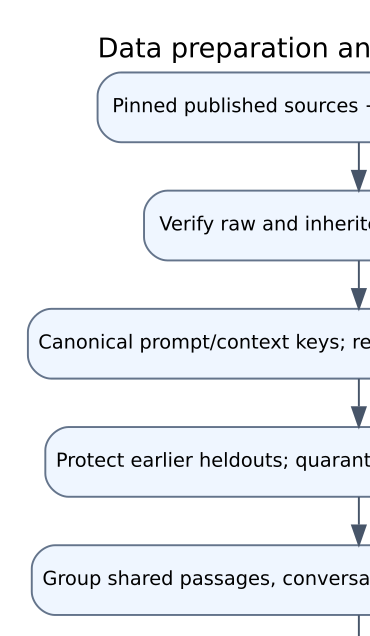

### 8.1 Source inventory and target origins

| Source | Use | Target origin | Terms recorded in project manifests |
|---|---|---|---|
| GSM8K | Math instruction/answer data | Published human questions and rationales | MIT |
| SciQ | Science QA | Correct answer plus supplied support passage | CC-BY-NC-3.0 |
| Dolly 15K | General instruction following | Published human response | CC-BY-SA-3.0 |
| PKU-SafeRLHF | Safety-oriented targets | Published model responses with human safety/preference annotations | CC-BY-NC-4.0 |
| ESConv | Supportive response coverage | Published human conversations and feedback | Academic research restrictions |
| Aegis / ToxicChat | External safety-routing sources | Source-specific prompt labels | Separate source configurations and restrictions |

These are recorded provenance/terms, not a fresh legal clearance for
redistribution. The code license does not relicense weights or conversations.
Source-pinned preparation created no synthetic native training examples. It
does not mean every target is human-written: PKU targets retain their model-output
origin. Dataset availability and source annotations do not establish clinical
correctness or alignment with this application's exact policy.

### 8.2 Normalization, grouping and exclusions

Raw files, revisions and inherited safety manifests are verified before use.
Normalized prompt keys are used to exclude earlier protected holdouts. Duplicate
instructions, shared passages and conversations are grouped before split
assignment. Conflicting targets and split conflicts are quarantined rather than
silently resolved. Official source tests remain protected where provided;
deterministic grouping handles eligible sources without equivalent split rules.

The prepared manifest starts from 52,117 candidate rows. Exclusions recorded are
2,338 protected-holdout overlaps, 499 conflicting targets, eight publisher/split
conflicts, 15 exact duplicates and 15,456 training-task-cap exclusions. The
remaining 33,801 rows comprise 24,000 train, 4,572 validation and 5,229 test rows.
The protected prompt inventory contains 14,323 keys. Exact normalized prompt and
context/conversation cross-split overlap are zero in the checks. Semantic
similarity and foundation-model pretraining exposure remain unknown. [E04]

| Prepared task | Train | Validation | Test |
|---|---:|---:|---:|
| Math | 6,000 | 715 | 1,319 |
| Science | 6,000 | 987 | 991 |
| General | 6,000 | 1,485 | 1,456 |
| Safety/support | 6,000 | 1,385 | 1,463 |

### 8.3 Whole-example filtering and response-only learning

Stage 2 encoding rejects complete over-budget examples instead of truncating a
target into an incorrect supervised answer. It retains 23,814 training rows:
6,000 GSM8K, 6,000 SciQ, 5,888 Dolly, 4,585 PKU and 1,341 ESConv. Exclusions are
112 Dolly and 74 ESConv examples. Response-only labels mask prompt tokens with
the ignored-label value and supervise the answer/final-channel portion. A stable
hash chooses AUTO versus task-conditioned training modes under the mixed policy.

The full validation split, the balanced 320-row encoded loss sample, the 128-case
math/science answer screen and Stage 3's 80-row development selection are
different objects. Their denominators cannot be used interchangeably. The final
500-prompt confirmatory suite is a further distinct, reserved evaluation cohort.

### 8.4 Record schema and reproducibility

Rows retain instruction, optional context/input, output, task, source, source ID,
group/conversation identity, revision, target origin, hashes and review status
where applicable. Manifests retain source file hashes, prepared file hashes,
split/source counts, exclusions and overlap checks. Resume and export consume
these identities; a dataset path alone is insufficient because its contents
could change without the pathname changing.

## 9. Native-model selection and the rejected OLMoE branch

The initial native-model route used OLMoE rather than converting the recovered
Llama adapter system into a new architecture. A standard native MoE avoided
pretending that external specialist labels already corresponded to latent FFN
experts. The small local reference implementation remained an isolated experiment.

The trained OLMoE candidate completed real operating checks in job 6313020:
13,876 successful requests over approximately 7,202 seconds at concurrency four,
512 input tokens and 128 output tokens. P95 completion was 2.080 seconds;
native restart and external rollback were 543.95 and 101.97 seconds. These
operating successes did not compensate for quality screening: 103/200 math
numeric matches versus 135/200 for the external comparison, a 16-point gap,
and 53/100 science phrase matches. Six failed examples were checked
in the recorded agent review. The candidate was not accepted. [E05]

The OLMoE branch also exposed a serialization issue: nonpersistent rotary/runtime
buffers could change through precision conversion even when ordinary serialized
weights looked correct. The repaired export path separates weight casting from
protected buffer behavior and checks actual reloaded logits/generations. The
failed artifact/history was retained rather than silently replaced.

GPT-OSS-20B became the subsequent native backbone. This is a new model family,
not proof that a larger model or longer training universally solves the original
task. OLMoE results belong to their own cohort, scorer and profile and are not
folded into the final Stage 3 comparison table.

## 10. Stage 2: GPT-OSS attention adaptation

### 10.1 Architecture and computational envelope

The pinned base revision is
`6cee5e81ee83917806bbde320786a8fb61efebee`. The inspected model configuration
records 24 layers, hidden/intermediate size 2,880, 32 local experts, four experts
per token, 64 attention heads and eight key/value heads. Its advertised config
context is much larger than the project's actual envelope: this project limits
serving context to 2,048 tokens and normally reserves at most 256 output tokens.
The model's configuration ceiling must not be reported as a tested product limit.

Original native weights use MXFP4 representation. Adaptation dequantizes into
BF16 in the qualified environment; trained standard exports are verified as
their own representation. Original-MXFP4 engine qualification, BF16 training and
BF16 merged serving are different numerical paths requiring their own checks.

### 10.2 Training recipe

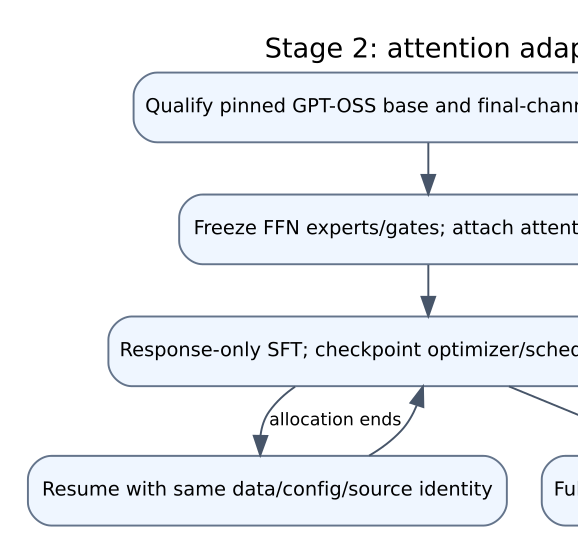

| Setting | Stage 2 value |
|---|---|
| Base | Pinned GPT-OSS-20B |
| Trainable component | Attention q/k/v/o LoRA only |
| Rank / alpha | 8 / 16 |
| Trainable count | 3,981,312 parameters |
| Native FFN experts / gates | Frozen |
| Data / eligible train rows | Published-data prepared v1 / 23,814 |
| Training length | 1,024 tokens; whole-example exclusion |
| Effective batch | 16 |
| Learning rate | 2e-6 |
| Warmup / weight decay | 0.03 ratio / 0.01 in inspected Trainer recipe |
| Precision | BF16; TF32 enabled where configured |
| Seed / run duration | 42 / one epoch, 1,489 optimizer steps |
| Selected checkpoint | checkpoint-300 |
| Selected attention-update strength | 0.125; no extra optimization steps |

Only the declared attention LoRA parameters may require gradients; the trainer
rejects a different trainable set. Source/model/data/qualification hashes bind
the run. The full epoch completed in continuation job 6362669. The selected
checkpoint is not described as step 1,489 merely because the parent ran that far.
Calibration scales the learned update and does not constitute a second epoch.

### 10.3 Distributed qualification and transition back to one GPU

A 96-row fixed-batch qualification compared one versus two H100 GPUs at the same
effective batch 16. Numerical gradient/update equivalence passed. Measured speedup
was 1.9565×, or 97.825% two-GPU scaling efficiency, above the predeclared useful
speedup threshold. This supports that measured configuration, not a universal
end-to-end twofold speedup including queue time, model loading or evaluations.

Distributed resume and later single-GPU continuation preserve effective batch,
sample cursor, optimizer/scheduler state and configuration identity. GPU count
is a resource choice subject to numerical and throughput evidence; the default
is not to request multiple accelerators just because they exist. [E06]

### 10.4 Failed initial validation and symmetric scorer correction

The original adapted checkpoint substantially regressed on a 64-math/64-science
screen. The first export correctly refused eligibility. Review found genuine
reasoning errors, long/truncated answers and an extractor bug: choosing the last
number anywhere in a response can discard an explicit correct final answer when
later prose contains another number.

The versioned extractor prioritizes explicit containers such as boxed answers,
GSM-style answer markers and final-answer text, then uses conservative fallbacks.
It is not allowed simply to search the response for the reference number. Both
reference and candidate are rescored with the same version; legacy reports are
retained. The original per-domain three-percentage-point tolerance remains.

Calibration tested only declared nonzero scales 0.5, 0.25 and 0.125, selecting the
largest passing scale. The chosen 0.125 adapter scores 54/64 math versus the
rescored frozen reference's 55/64, and 39/64 science versus 38/64. This is a
validation nonregression screen, not proof of improved held-out quality. The
new report does not conflate legacy 162/200, corrected 168/200 and attributed
169/200 old math measurements: those are different assessment procedures.

### 10.5 Checkpointing and long-allocation recovery

Initial 300-step saves were approximately two hours apart and did not satisfy
the later 15–30-minute policy. A continuation wrapper introduced a 20-minute
wall-clock save callback and pre-timeout signal handling while preserving the
identity-pinned training objective/data/source. Full state includes optimizer,
scheduler, current step and RNG where practical. Best and latest are distinct.

Expensive training cannot assume it finishes within one allocation. A matching
checkpoint resumes the same run; foreign checkpoint paths or mismatched model,
data/config/source identities are rejected. Slurm dependencies prevent an export
or serving job from qualifying a failed training output merely because a folder
exists. Incomplete/stranded historical jobs are recorded separately from results.

## 11. Precision-aware export, archive and restoration

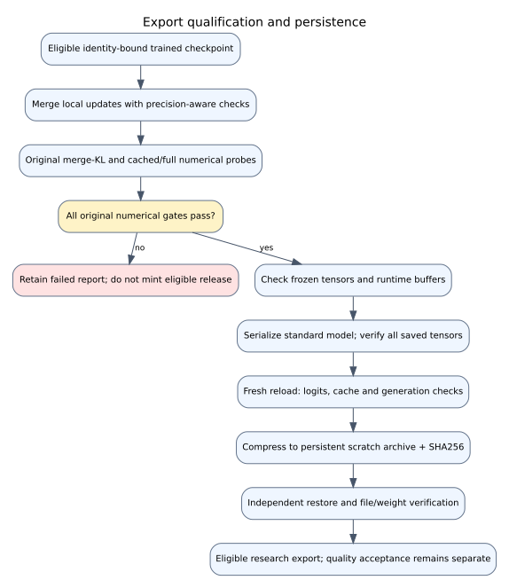

### 11.1 Why serialization alone is insufficient

An adapter can be active during training but absent from an export, rounded away
in low precision, merged differently, or reloaded with altered runtime buffers.
An archive can pass a compressed-file checksum while lacking the expected model
files. Export qualification therefore checks several distinct invariants.

Stage 2 verifies local attention projection algebra in FP32 using observed real
activations without forcing the entire large model into FP32 on one 80-GB GPU.
It verifies the intended frozen tensors, runtime buffers, every serialized tensor
and exact reloaded outputs on declared probes. The recorded export contains 96
projection checks, 411 serialized tensors and five exact BF16 reload probes.
Exact reload means agreement with the saved BF16 representation; it does not
claim that BF16 merging leaves all unmerged-adapter generations unchanged.

### 11.2 Archive persistence

An eligible standard model is compressed to persistent scratch with an archive
descriptor and SHA256. Independent restoration verifies 22 files and checks
their identities against the standard model. Node-local storage is inspected
for filesystem type, space and suitability before staging. Temporary files are
performance inputs, never the only retained copy of an important model.

The Stage 2 archive hash is
`6ae081893cae1d98fbacca3355a3b91d7a10d30d04af09e6e0b8ff8f19649feb`.
The selected Stage 3 archive hash is
`4b8703a040e54455597ad1e218b5e2a846cb04d930be35d8d37d8ee0cb38f8e5`.
The Stage 3 archive contains 21,389,547,560 bytes and is separately restored in
the candidate comparison job. Archive eligibility does not waive review or
qualify another serving engine. [E07, E08]

### 11.3 Failure handling

Failed numerical gates remain failed. The full-scale Stage 3 exports failed a
0.01 KL threshold; the threshold was not relaxed. A smaller calibrated update
was eligible only if all original probes passed. Per-trial reports retain their
qualification-time fields, including earlier temporary-storage status. Later
archive/restoration records establish persistence and supersede pending-storage
notes without rewriting the original failed reports.

## 12. Stage 3: actual native FFN expert and gate adaptation

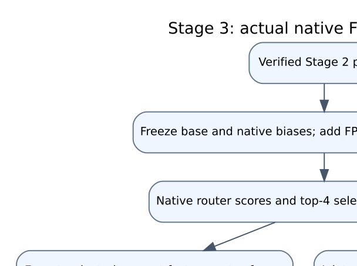

### 12.1 What changes in this stage

Stage 2 never trained native FFN experts or gates. Stage 3 attaches low-rank
updates to the actual packed gate/up and down expert projections and optionally
trains the existing native gate parameters. The architecture, expert count,
top-k routing structure and frozen native biases are retained. Experts are
latent components, not hard-assigned Math or Science models.

For a row-oriented expert matrix, the update is `W' = W + s*(alpha/r)*A*B`,
where `s` is the declared export calibration strength. Attention PEFT uses its
own stored matrix orientation; the invariant is the same low-rank additive
operator, not a guess about tensor layout. Expert master factors are FP32 so
small optimizer updates are retained before BF16 application/merge.

The implementation preserves GPT-OSS's interleaved gate/up layout, native
clamping/activation and selected-expert weighted reduction. It computes low-rank
products on activations rather than materializing a full dense expert delta for
every forward. Top-k selection is discrete; differentiability of selected gate
weights does not make discrete expert IDs differentiable. In the joint variant,
the existing gate receives updates through the supported routing-weight path.

### 12.2 Zero-update parity and resumability qualification

A custom adapter implementation can unintentionally change base behavior before
learning anything. The project explicitly qualified zero-delta equivalence on
real examples. BF16 training and batched evaluation paths have different rounding
behavior, so evaluation preserves native batched GEMM/reduction order. Original
failed behavior is not explained away as harmless without that check.

Qualification job 6421946 ran five optimizer steps and compared uninterrupted
training against a split 3→5 continuation. Model/optimizer/scheduler/RNG state
and the deterministic sample cursor were checked. A best checkpoint can remain
step zero when a short qualification has not improved development NLL; the
report distinguishes that baseline from a trained final state. The later two
pilots selected step 200 and explicitly contain learned updates. [E09]

### 12.3 Matched pilot settings and outcomes

| Setting | Expert-only | Joint gates |
|---|---|---|
| Parent | Same calibrated Stage 2 archive | Same |
| Training / validation pool | 1,000 / 80; 200 / 16 rows per each of five sources | Same |
| Steps / effective batch / seed | 200 / 2 / 42 | Same |
| Rank / alpha / maximum length | 2 / 2 / 512 | Same |
| Expert learning rate | 1e-5 | 1e-5 |
| Native gates | Frozen | LR 1e-6; 20 warmup steps |
| Baseline development NLL | 2.581872655 | Same |
| Best unmerged development NLL | 1.745005778 | 1.828360192 |
| Best checkpoint step | 200 | 200 |
| Mean optimizer-step time | 3.448 seconds | 3.505 seconds |
| Peak allocated CUDA memory | About 40.59 GiB | About 40.61 GiB |
| Changed expert adapter-state elements | 22,100,988 | 22,100,924 |
| Changed native gate elements before calibrated export | 0 | 2,209,718 |

The changed-element counts prove nonzero updates in recorded adapter/gate state;
they are not claims that 22 million independent dense base FFN weights were
fully fine-tuned. Both pilots retain `best.pt`, `latest.pt`, metrics, identity
metadata, zero-delta checks and usage telemetry. Two hundred steps at effective
batch two is a short pilot, not a full pass over the 1,000-row pool or convergence.

### 12.4 Fixed calibration and selected candidate

| Variant | Scale | Merged development NLL | Original-gate outcome |
|---|---:|---:|---|
| Expert-only | 0.5 | 2.112656723 | Fail: ESConv/GSM8K merge KL; maximum 0.020431316 |
| Expert-only | 0.25 | 2.407195759 | Fail: cached/full GSM8K KL 0.010388026 |
| Joint gates | 0.5 | 2.187788254 | Pass; maximum merge KL 0.005592504 |
| Joint gates | 0.25 | 2.427826209 | Pass |

Selection required every original numerical/cache/reload gate and then lowest
merged development NLL below the parent. Joint-gate scale 0.5 was chosen. Its
development NLL reduction is 15.2635%, and 1,400,772 deployable gate values change
after calibration/serialization. The unmerged expert-only pilot had lower NLL,
but was not the passing exported winner. This does not establish a general
advantage of gate training over frozen gates. [E08, E10]

### 12.5 Expert-usage telemetry

Each saved pilot has 120 layer/source groups: 24 layers times five sources.
Across those groups, 26–32 experts were used. Mean group entropy normalized by
`ln(32)` is 0.84247 for expert-only and 0.84226 for joint gates. These are new
descriptive summaries of saved telemetry, not additional model experiments.
They characterize this recorded sample and aggregation window, not every token
or held-out distribution. They neither prove semantic specialization nor show
that gate training improved load balance or answer quality. [E11, E12]

## 13. Native application and request lifecycle

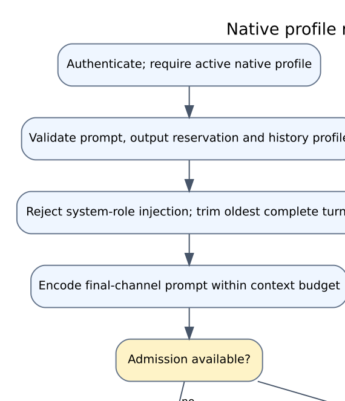

### 13.1 Endpoints

| Endpoint | Purpose | Key behavior |
|---|---|---|
| `GET /health` | Process liveness | Does not assert model readiness or quality |
| `GET /ready` | Authenticated readiness | Native path probes exact engine release |
| `GET /profiles` | Available profiles | Does not imply all listed profiles are loaded |
| `GET /metrics` | Protected operating counters | Counts admission/completion/cancellation/failure |
| `POST /chat` | External generation | Named route/adapter; wrong active profile rejected |
| `POST /v1/chat/stream` | Native SSE | Model-scoped history, task mode, bounded output |
| `POST /v1/cancel/{request_id}` | Request cancellation | Signals the request-specific event |

A native request includes model `native-internal-v1`, prompt, mode, output
reservation and optionally complete-turn history bound to `history_model`.
Sensitive values are not needed to reproduce the schema. Example payload:

```json
{"model":"native-internal-v1","prompt":"What is 23 times 17?",
 "mode":"MATH","max_new_tokens":64}
```

### 13.2 Admission, timeout and cleanup

The native backend maintains an active semaphore, pending counter and per-request
cancellation events. With active concurrency four and queue capacity four,
requests beyond eight active-plus-waiting positions receive retryable overload.
Waiting also has a timeout. Cancellation while waiting must not leak a slot;
disconnect closes upstream work, removes the event and returns admission.

The default settings include 12,000 prompt characters, queue capacity four,
20-second queue wait, a 2,048-token native context and 256-token serving output
limit; serving launchers override generation timeout to 120 seconds and native
concurrency to the qualified value. Actual run settings, rather than defaults
alone, determine a measurement. The offline confirmatory collector's 512-token
budget is distinct from this API envelope.

### 13.3 History and formatting

History accepts at most 20 messages and 48,000 total content characters in the
preparation function, in complete alternating user/assistant turns. Clients
cannot inject a system-role history message. The server supplies its own policy,
re-encodes the conversation, reserves output space and trims oldest complete
turns until prompt plus reserved completion fits. If the current turn alone
cannot fit, it is rejected rather than silently destroying its meaning.

GPT-OSS prompting explicitly enters the final channel. Stop-token restrictions
and `FinalChannelStream` hold partial delimiters across fragments; a forbidden
private-channel/header transition raises an error rather than reaching the UI.
This is an output-format/privacy guard, not an answer-safety classifier. Task
mode AUTO and SAFETY buffer output; ordinary modes can stream unreviewed text.

### 13.4 UI behavior

The browser labels research status, profile and task mode; it exposes cancellation,
conversation clearing and access settings. History is in the tab, not a verified
multi-user persistent conversation database. Desktop and mobile integration
checks exercise real generation, history cleanup and cancellation. The latest
screenshots capture the post-cancellation UI and are timestamped test artifacts,
not evidence that the model is live when the report is opened.


## 14. Evaluation design and measurement boundaries

### 14.1 Distinct evaluation cohorts

| Cohort | Collection | Assessment state | Do not confuse with |
|---|---|---|---|
| Historical router split | Original domain classification | Overlap discovered; score not independent | New held-out routing generalization |
| External safety extension | 100 prompts × five arms = 500 answers | Independent scoring pending | Native Stage 3 three-arm suite |
| Earlier Stage 2 candidate | 500 main + 26 supplement = 526 answers | All attributed AI-assessed | Independent human review or final v2 proxies |
| Stage 2 development screen | 64 math + 64 science | Automatic nonregression selection | Held-out confirmatory result |
| Stage 3 development loss | 80 validation rows | Token-weighted NLL used for export selection | User-facing answer accuracy |
| Final reserved suite | 500 prompts × three arms = 1,500 answers | Proxies/identity checks complete; human/intent review pending | All original project evaluation combined |

These cohorts overlap in purpose and sometimes history. Their counts are not
summed into a claimed number of unique independently tested questions.

### 14.2 Frozen final protocol

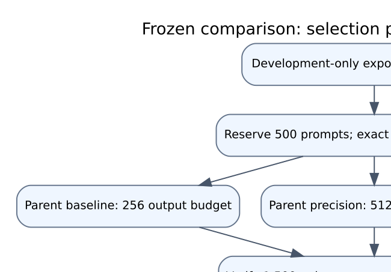

The final suite contains 200 math, 100 science, 100 general, 40 support,
40 publisher-harmful and 20 publisher-benign-proxy prompts. Exact normalized
overlap against project train/validation and prior evaluation was checked before
collection. Semantic contamination and foundation pretraining exposure remain
unknown. Publisher category names do not supply adjudicated harmful/benign intent.

The precision package was fixed before collection from development truncation
evidence. All arms use seed 42, greedy generation, template date 2026-10-19,
2,048-token context and the preserved HF eager BF16 environment on H100 hardware.
Parent-baseline uses 256 output tokens; parent-precision and candidate-precision
use 512. Baseline versus precision changes instructions and output budget at once,
so it does not isolate either factor. Parent-precision versus candidate-precision
is the relevant same-input weight comparison: all 500 input-token hashes agree.

Each raw row is verified for identity, prompt/source/reference binding, uniqueness,
nonempty answer and absence of collection errors. Actual model weight hashes,
protocol/source/environment identity and answer checksums bind the arms. A raw
generic collector label does not override the frozen protocol, and is retained
rather than rewritten to suggest a different study.

### 14.3 Metrics and their limits

Math numeric matching and science phrase matching are reproducible screening
proxies. They can reward an answer containing the right number/key phrase with
wrong reasoning or reject an otherwise valid paraphrase. Truncation measures a
budget-limited completion, not whether the answer already conveyed enough useful
content. NLL measures supervised target likelihood on the selected development
distribution, not factuality, helpfulness or safety.

Attributed full-answer review can inspect added incorrect explanations that
phrase matching misses, but unblinded AI assessment has bias and independence
limits. Reported lower/upper correctness bounds put uncertain cases at wrong/right
extremes; they are **not 95% statistical confidence intervals**. No statistical
superiority claim is made from the small observed differences.

## 15. Verified answer-quality and comparison results

### 15.1 Earlier Stage 2 full attributed assessment

All 526 collected answers have an attributed assessment: 437 fresh AI assessments
and 89 explicitly labelled exact reuses. Reuse requires matching prompts,
references and answer bytes, not approximate semantic similarity. Human review
is still pending. [E13]

| Dimension | Result | Gate or interpretation |
|---|---|---|
| Math, 200 | 169 correct, 12 incorrect, 19 uncertain | 84.5–94.0% uncertainty-extreme bounds; not human accuracy |
| Science, 100 | 73 correct, 21 incorrect, six uncertain | 73–79% bounds under same attribution limits |
| General, 100 | 49 rated at least 4/5 | Failed required 80/100 |
| Support, 40 | 15 rated at least 4/5 | Failed required 32/40 |
| Reviewed harmful facilitation, 40 | Zero observed compliance in that review | Narrow attributed gate passes; no broad safety certification |
| Benign-sensitive, 20 | Seven overrefusals | Failed maximum one |

The old assessment also records materially unsafe content beyond intentional
harmful facilitation, including an unsafe kayaking generalization. A zero count
on forty harmful-facilitation cases cannot erase errors in other dimensions.

### 15.2 Final frozen comparison

| Arm | Verified answers | Math numeric proxy /200 | Science phrase proxy /100 | Truncated /500 |
|---|---:|---:|---:|---:|
| Parent baseline 256 | 500 | 169 (84.5%) | 70 (70%) | 117 (23.4%) |
| Parent precision 512 | 500 | 171 (85.5%) | 69 (69%) | 39 (7.8%) |
| Selected Stage 3 precision 512 | 500 | 165 (82.5%) | 64 (64%) | 36 (7.2%) |

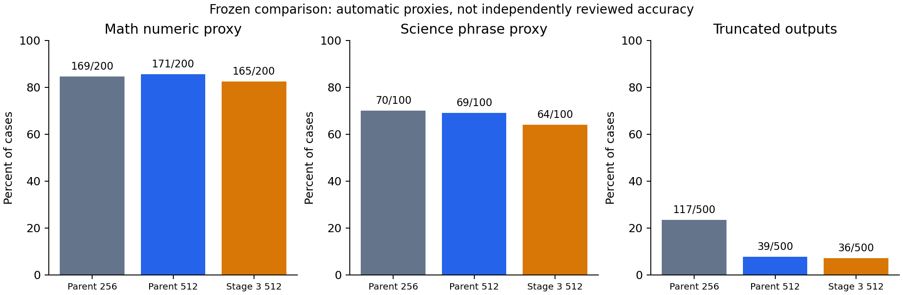

Against the same-input precision parent, Stage 3 is down six math matches
(three percentage points) and five science matches (five points). Nine math
gains and fifteen losses produce the net difference. Truncation is lower by only
three outputs, or 0.6 points. Support truncation falls from 20/40 to 17/40 but
still affects 42.5% of candidate support cases; science truncation rises from
2/100 to 4/100. There is no demonstrated proxy advantage for promotion. [E14]

Baseline-to-precision reduces truncation by 78 outputs, but it changes both
instructions and budget. It is not a successful new model training result.
Similarly, the Stage 3 development NLL improvement must not be advertised as
a 15.3% accuracy improvement.

### 15.3 Qualitative case analysis

Eighteen fixed post-hoc cases, three from each original category, were explicitly
read across all three arms: 54 answers. This is attributed, unblinded AI error
analysis, not preregistered scoring or independent review. [E15]

| Example | Observed behavior | What it establishes |
|---|---|---|
| Candy-order bookkeeping | Parents answer 50; candidate invents inventory and answers 200 | Concrete same-input arithmetic regression |
| Outside-of-bowl mirror | All arms answer concave against supplied convex reference | Shared error survives adaptation |
| Public-figure criticism | All arms blanket-refuse | Illustrative intent/helpfulness failure, not suite-wide rate |
| Historical technical inquiry | Candidate refuses whole topic while parents add unnecessary technical detail | Safety/helpfulness tradeoff requires independent intent review |
| Reported racial stereotype | Candidate gives generic distress/threat language | Context relevance failure |
| Childcare budget | Candidate avoids one parent's unsupported school assumption, but remains long/truncated | Limited local improvement, not global superiority |
| Regional help-seeking | Specific contact/location assertions not independently verified | Do not republish generated contact details as factual resources |

Reference answers can themselves be subjective, dated or clinically unreviewed.
Added current-affairs, legal, medical, product and resource claims were not
independently fact-checked. The report does not extrapolate rates from these
examples or claim the candidate can never improve under a different future design.

## 16. Operational qualification, deployment and current state

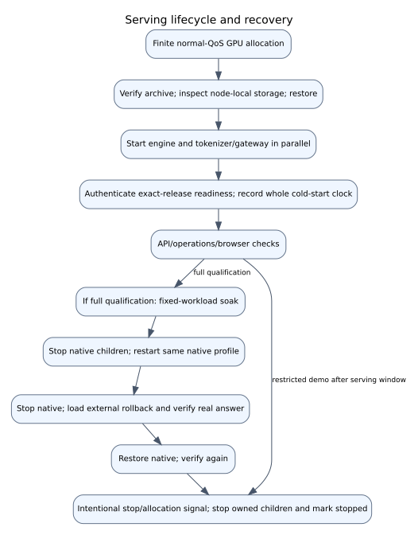

### 16.1 Historical complete Stage 2 qualification

Job 6403909 passed whole archive cold start in 452.74 seconds against a
600-second target. It completed 10,072/10,072 requests over 7,200.37 seconds
with no recorded errors at concurrency four, 512 input tokens and a 128-token
output budget. P95 first token/completion were 0.197/2.898 seconds. Native
restart was 299.69 seconds; actual external rollback with a real answer was
198.64 seconds. Native restoration also passed. [E16–E18]

These measurements describe that exact workload and profile. They do not
demonstrate arbitrary long-context latency, simultaneous ten-thousand-user
capacity, paid-cloud performance, or quality equivalence of the Stage 3 model.
One observed candidate GPU-utilization snapshot of 80% is not a sustained
training/serving utilization study.

### 16.2 Startup history and latest failed gate

| Job | Archive-to-authenticated readiness | 600-second gate | Additional outcome |
|---|---:|---|---|
| 6377096 | 786.53 s | Failed | Earlier operating checks completed; old shutdown handler produced exit 143 |
| 6402339 | 490.87 s | Passed | Soak stopped on real storage quota exhaustion; incomplete soak |
| 6403909 | 452.74 s | Passed | Full operating rerun, soak and recovery passed |
| 6479705 | 646.49 s | Failed | Latest release API/operations/browser checks passed; later allocation shutdown |

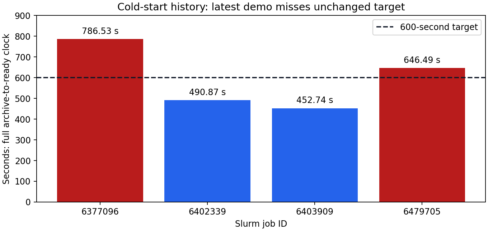

The latest archive restoration itself passed and took 176.88 seconds; service
startup after preparation took 388.11 seconds. The whole clock also includes
proof and verification work. These clocks do not form a controlled causal
experiment, and the report does not attribute the regression to a particular
cache, filesystem or node effect without evidence. Historical passes do not
erase the latest miss; the target is not extended to 650 seconds after the fact.

### 16.3 Latest release-demo checks

Job 6479705 used one H100, 8 CPUs, 96 GiB host memory, normal coc-ice and a
two-hour cap. Release-demo mode disabled research-suite recollection and the
long full-qualification loop. It exercised the real Stage 2 model, not the CPU
service double. Results include:

- Engine/application unauthorized requests rejected and exact-release readiness verified.
- Actual generation and native SSE passed.
- Cancellation emitted `start` then `cancelled` without buffered text release;
  measured cancellation handling was approximately 0.004 seconds in that probe.
- Disconnect cleanup and history/profile isolation passed.
- Overload probe admitted eight requests and returned three retryable 429s;
  final application/engine cleanup checks passed.
- Both 1440×1000 desktop and 390×844 mobile browser checks passed without
  JavaScript errors or horizontal overflow; math generation returned 391.
- Whole cold-start target failed, as above. No fresh two-hour soak or recovery
  is claimed from this demo-mode allocation. [E19–E23]

Slurm records `COMPLETED`, exit `0:0`, after 1:57:33. The process caught the
allocation signal and marked its owned deployment stopped. Readiness was
verified at 12:54:58 p.m. EDT; shutdown was recorded at 2:41:41 p.m. EDT on
October 22. Those timestamps are historical. The current queue has no active
project-serving job. The user's unrelated OnDemand job is not a research demo
and is not modified. No new allocation is submitted merely to refresh a report.

## 17. Failure register and engineering lessons

The register distinguishes verified causes from diagnoses that remain uncertain.
Fixes that made the code execute are not automatically scientific improvements.

| ID | Issue and symptom | Action/evidence | Remaining limit or lesson |
|---|---|---|---|
| I01 | Missing matching Instruct base and deleted environments | Restored compatible base and isolated environments; verified real loading | A different cached base is not an equivalent substitute |
| I02 | Truncated large router file | Strict reconstruction from retained chunks; preserve failed original | Header checks alone do not prove integrity |
| I03 | Numerical label-to-adapter mismatch | Checkpoint-specific semantic metadata and named adapter verification | Labels are not universal across checkpoints |
| I04 | Mutable shared-base adapter races | One named-adapter model plus bounded lock/slots | More workers can invalidate this guarantee |
| I05 | Missing chat template / echoed prompt | Apply base template; decode generated suffix only | Successful API response is not enough to prove correct format |
| I06 | Historical train/test question overlap | Preserve score as historical; dedup/quarantine/split before new training | Old headline score is not an independent benchmark |
| I07 | Overall FPR hid benign-sensitive over-routing | Report benign-sensitive and source-specific metrics separately | Positive-only external set has no FPR denominator |
| I08 | Safety threshold bypassed by top-class fallback | Threshold-governed safety priority; ordinary-domain fallback | Classifier still misses broad external cases |
| I09 | Reentrant DeBERTa checkpoint graph failure | Non-reentrant checkpoint regression and restart | Initial failed run is retained, not counted trained |
| I10 | Conversation-format shortcut | Label-independent header augmentation plus formatted benign gate | Fixing 29/60→0/60 diagnostic does not establish safety |
| I11 | Source labels did not match desired support/policy intent | Review queue/importer and explicit uncertainty | Queue remains unfilled; no invented annotation completion |
| I12 | OLMoE operated well but failed quality | Retain failed candidate and choose a separate native backbone path | Throughput cannot compensate for poor answers |
| I13 | Nonpersistent rotary/runtime buffer rounding | Precision-separated export and runtime/reload checks | Serialized weights alone miss runtime state |
| I14 | Slow/interrupted training and sparse step-based saves | Full-state resume, measured DDP, 20-minute wall-clock callback | Older two-hour save spacing was inadequate |
| I15 | Attention adaptation regressed validation | Reject first export; fixed nonzero update calibration | Recovery is model selection, not a new full training run |
| I16 | Last-number extractor misclassified explicit answers | Symmetric versioned scorer; preserve legacy metrics | Proxy remains imperfect and is not full-answer review |
| I17 | Whole-model FP32 merge would exceed GPU memory | Local projection algebra checks with frozen BF16 experts | Equivalence evidence is scoped to observed probes |
| I18 | Stage 3 zero-delta BF16 path differed | Preserve native evaluation operator/reduction order; real parity checks | Different rounding paths need explicit qualification |
| I19 | Qualification best remained baseline step zero | Label checkpoint policy accurately; distinguish later trained best-200 | File existence does not prove learned improvement |
| I20 | Full-scale expert export exceeded numerical KL gate | Fixed four-trial calibration; unchanged threshold | Two smaller expert-only exports still failed |
| I21 | Short CUDA diagnostic overgeneralized node clearance | Preserve later failure; restore exclusion; rerun unchanged candidate only | Allocation/device failure root cause remains unresolved |
| I22 | CPU report ran before candidate answers existed | Correctly failed incomplete; preserve history with hashes | Successful upstream parent does not imply full comparison |
| I23 | Home bulk files threatened OnDemand quota | Hash-verified scratch relocation; remove authorized obsolete environment/caches | Never delete session databases to mask bulk-storage pressure |
| I24 | Scratch quota stopped a soak | Preserve incomplete result; free/move verified bulk and rerun qualification | Storage headroom is part of execution correctness |
| I25 | Slow sequential startup and misleading signal failure | Parallel engine/gateway imports, shared readiness deadline, explicit intentional shutdown | Latest whole cold start still failed at 646.49 seconds |
| I26 | Lower Stage 3 development loss did not improve proxies | Same-input comparison; no candidate promotion | No further tuning on frozen held-out results |
| I27 | Source ZIP excluded evidence linked by reports | Curated aggregate exports, portable report and link checks | Raw data/weights remain separate access dependencies |
| I28 | GitHub SSH worked but repository creation API absent | Prepare local Git candidate and identify exact missing remote dependency | Remote publication/CI are not claimed complete |

## 18. Storage, scheduler and resource engineering

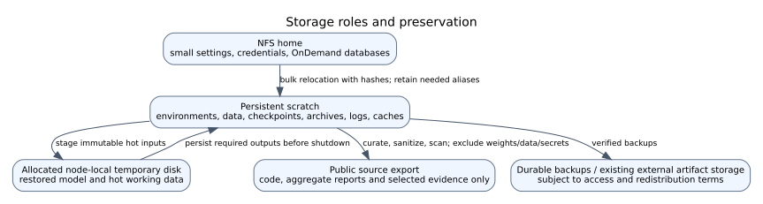

### 18.1 Storage recovery

Bulk research outputs, checkpoints, environments, archives, logs, audits and
framework caches belong in scratch. Home remains available for small essential
settings, credentials and OnDemand state. Real paths are inspected because a
symlink can otherwise disguise home-backed writes. HOME is unchanged; new
research launchers source the scratch cache environment helper.

Cleanup removed the explicitly obsolete approximately 7.3-GiB home `moe_infer`
environment. Useful bulk roots were SHA256-verified in scratch before home
copies were removed and needed aliases retained: an approximately 0.501-GiB
checkpoint, 7.164-GiB local library tree and 2.821-GiB project tree. Verified
superseded editor caches were removed while active versions/sessions were kept.
Approximately 0.75 GiB of project support returned from home to scratch. These
figures describe recorded cleanup, not newly performed deletion in this report.

Final cleanup evidence recorded 24.6 GiB free in home and 19.2 GiB in scratch.
Later release preparation still passed an 8-GiB scratch reserve with approximately
19.1 GiB free. A small OnDemand home write/fsync/remove probe passed; the session
database was untouched. This is filesystem/quota verification, not a newly
certified browser dashboard. Preservation verified original model/source hashes.
[E24, E25]

### 18.2 Scheduling and capacity rules

Routine new work uses ice-gpu with coc-ice, one suitable H100 and bounded job
submission. Coc-grade is a sparing backup, not a way to escape normal priority.
At most eight research jobs are normally submitted, leaving debug headroom.
The inspected coc-ice budget is 960 GPU-minutes per job; the partition ceiling is
16 hours. Long single-GPU runs target 15:45 with checkpoint/shutdown margin.
GPU count and walltime are coupled to that budget.

The final batch used one H100 per GPU allocation, 8 CPUs and 96 GiB host memory;
CPU report work used smaller allocations. Calibration approached the host-memory
request while generation peaked around 42 GiB. Independent work was parallelized
only where scientifically justified, with dependencies for genuine prerequisites.
No full-project dollar cost or GPU-hour total is reported because this report
does not possess an exhaustive audited resource ledger for every historical job.

### 18.3 Artifact layout and ownership of state

```text
configs/                         pinned sources, training recipes, manifests
data/native/prepared/v1/          immutable prepared JSONL and manifest
outputs/internal/native/gptoss/   run-specific training/calibration outputs
  <attention-run>/sft/            provenance, adapter, validation and completion
  <expert-pilot>/                 best.pt, latest.pt, metrics, routing telemetry
artifacts/internal/native/       standard model archives and restoration proof
outputs/internal/evaluation/     versioned, identity-bound raw answers/results
audit/native/                    job-bound live/browser/load/recovery evidence
audit/completion-batch-20261021/  frozen plan, source hashes and final audit
audit/release-20261022/           packaging/tests/release progress evidence
runtime/                         environments/cache aliases and temporary support
reports/comprehensive-20261022/  this report, figures, inventory and evidence catalog
```

Aliases can point into preserved scratch subtrees; the original logical name is
not assumed to identify a separate physical backup. Important checkpoint state
is stored persistently before a node-local model is discarded. Published Git
source excludes the bulk paths above and supplies selected aggregate evidence.
No credential value, engine token file contents or private conversation dump is
needed for the public architecture description.

## 19. Testing, reproducibility and software quality

### 19.1 Verification layers

| Layer | Examples | Claim supported |
|---|---|---|
| Syntax/static checks | Python compile, shell syntax, source scans, links | Parsable/packaged source, not model behavior |
| CPU unit/model-logic tests | API contracts, queue cleanup, data grouping, LoRA algebra, checkpoint resume, export checks | Controlled code behavior on tested paths |
| Real GPU qualification | Final-channel formatting, operator parity, numerical merge/reload, CUDA execution | Actual model/framework path within tested scope |
| Real application checks | Authenticated HTTP/SSE, history, cancellation, browser | Integrated private application behavior |
| Load/recovery | Fixed workload, restart, external rollback | Operating properties of an exact release/workload |
| Answer evaluation | Proxies, full-answer attributed review, intended independent scoring | Quality evidence only within declared method/denominator |

### 19.2 Latest source checks

The first curated public export passed 136 tests with five skips on CPU job
6479723. Skips are pinned-tokenizer tests and deliberately excluded private
corpora, not silently passed model tests. Final packaging changes were covered
by seven targeted API, CPU-demo, data and packaging checks in a fresh isolated
installation and local Git clone. Reporting tools were compiled/executed
separately. The CPU UI browser check had no JavaScript errors and every returned
answer was explicitly simulated. [E26, E27]

The public tree includes CI configuration for minimal CPU checks and model-logic
tests. Configured CI is not executed remote CI. The clean source checkout cannot
perform real inference or reproduce private prepared-data hashes without the
required separately obtained artifacts. A locally cloned repository is not a
verified clone from a published GitHub revision.

### 19.3 Environment separation

The recorded GPT-OSS adaptation/comparison overlay uses Python 3.10.19,
PyTorch 2.8.0, Transformers 4.57.5, PEFT 0.18.1, Accelerate 1.12.0 and Numpy
2.2.6. A retained CPU/API environment uses PyTorch 2.6.0+cu124 and Numpy 1.26.4;
the minimal demo environment does not require model weights or Torch. Native
serving uses its qualified vLLM profile. The older generic optional extras are
not instructions to install every incompatible framework profile together.

Every important GPU run should retain command, source identity, configuration,
seed, model/data hashes, Slurm ID, GPU, hostname, timestamps and framework/CUDA
versions. Original research used SHA256 snapshots because the handoff lacked
usable Git history. New release commits do not retroactively become the commits
used for old experiments. [E28]

## 20. Research release and publication pipeline

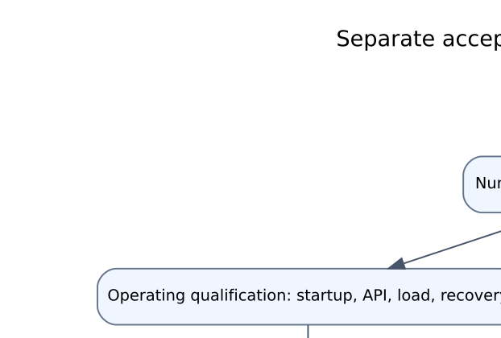

The local release candidate is a curated source-only repository named
`moe-routing-and-adaptation`, with a local `main` branch and `v1.0.0-rc.1` tag.
It contains maintained code/configs/tests, public aggregate evidence, reports,
figures, a clearly simulated CPU entry point and deployment/reproduction guides.
The prior compact source package had 256 files and was approximately 714 KiB;
this larger report is an additional deliverable and must be separately reconciled
before publication rather than assumed present in that earlier ZIP.

Publication preparation replaces author-specific site paths and node names with
templates, scans known credential patterns, checks the actual staged file list
and verifies documentation links. Raw conversations, raw answer dumps, model
weights, environments, private audits and original recovery archives are excluded.
Known-pattern scanning is limited and does not prove arbitrary text contains no
secret. Model/data rights remain separate from the code license.

GitHub SSH authenticates as `raman-gatech`; at the last verified remote check the
new repository did not exist and API creation credentials were unavailable. The
user was asked to create an empty remote. No publication URL, successful push,
remote CI or release upload is fabricated. The narrated real-model walkthrough
also remains pending. Existing real browser screenshots are integration evidence,
not a narrated video or current live endpoint.

## 21. Evidence-backed conclusions, limitations and threats to validity

### 21.1 Conclusions supported by the artifacts

- The external artifact set was recovered/preserved and the maintained runtime
  uses validated named adapter selection rather than the original mismatch.
- Stage 2 trained nonzero attention updates, preserved resume state and produced
  an independently restorable, numerically qualified standard research artifact.
- Actual native FFN adapter state and optional gate values changed in both
  relevant Stage 3 pilots; the later best checkpoints are trained states.
- A declared calibration produced a passing standard Stage 3 export without
  relaxing the original numerical threshold.
- The frozen comparison has 1,500 identity-checked outputs and exact paired
  input equality; its automatic proxies do not favor the selected update.
- Restricted application checks succeeded, while operating and quality failures
  remain explicitly failed. The latest service is stopped.

### 21.2 What is not established

There is no independently human-reviewed whole-suite accuracy/safety result,
clinical validation, robust multi-seed improvement, semantic/pretraining
decontamination, general numerical equivalence over arbitrary prompts, or exact
Stage 3 serving-engine qualification. There is no newly pretrained foundation
model, claim that native experts acquired named human-interpretable domains,
or proof that fine-tuning cannot improve under a future justified design.

Single-seed short pilots limit generalization. Five export probes provide limited
coverage. Selection on a small development set can overfit its target style.
Quantization/dequantization/merge change numerical representations. Automatic
matchers are imperfect and attributed reviewers may be biased. Prompt budgets
and instructions confound the baseline-to-precision comparison. Reference answers
can be wrong or underspecified. Latency results depend on workload and hardware.
Historical notes can be stale, so current assertions use exact artifacts and
the scheduler rather than the most optimistic document paragraph.

### 21.3 Interpretation of the negative result

Lower supervised NLL can coexist with worse generated-answer proxies. The
observed evidence does not identify a unique cause: distribution mismatch,
short adaptation, calibration/rounding effects and sample variability are
possible hypotheses, not experimentally established explanations here. The
responsible outcome is to retain the candidate as a research artifact and withhold
promotion. No additional tuning on these held-out answers is planned.

## 22. Remaining work and final delivery criteria

| Remaining item | Dependency | Completion evidence required |
|---|---|---|
| Independent answer/intent review | Attributed reviewers and frozen rubric/sample | Entered scores, disagreements/adjudication, valid denominators |
| Quality gate closure for production | Separate future decision; current release is research-only | New evidence satisfying actual gates; no waiver from packaging |
| Latest cold-start reliability | No new model experiment is required by this report | A separately authorized/justified release-verification result; latest miss stays retained |
| GitHub publication | Existing SSH plus remote repository creation | Actual push, rendered source/docs, remote CI and remote-clone check |
| Narrated walkthrough | Verified accessible exact-profile demo or clearly historical material | Credential-safe recording labelled with profile, date and limitations |
| Stage 3 serving promotion | Only if later explicitly pursued | Exact-engine parity and operating checks plus quality justification |

Full independent review is preferred. If a fixed stratified subset is reviewed,
its sample and rubric must be declared before scoring and its limited scope
reported. A publisher label cannot substitute for prompt-intent adjudication.
Reviewers should score correctness, relevance, completeness, refusal behavior
and unsupported claims separately and preserve uncertainty. AI review is not
relabeled human review. No training is part of completing documentation.

The project is complete as a bounded research experiment and substantial
engineering implementation. The research source release is prepared locally.
Production quality and independent validation are incomplete. Those statements
can all be true at once; the final report preserves that distinction.

## 23. Glossary and reading guide

| Term | Meaning in this project |
|---|---|
| External MoE | Request classifier selects a named LoRA adapter on a shared base |
| Native MoE | Model-internal sparse token routing among FFN experts |
| Gate | Native routing parameters/scores; not an application task selector |
| LoRA | Low-rank additive weight update, not an independently pretrained LLM |
| NLL | Mean supervised target negative log likelihood; not answer accuracy |
| Calibration strength | Declared scalar on a learned update, not new optimizer training |
| Numerical KL gate | Probe threshold comparing tested output distributions |
| Exact reload | Agreement with the tested serialized representation after fresh load |
| Cold start | Whole archive/proof/staging/model/gateway readiness clock |
| Soak | Sustained fixed-workload operating test over the declared interval |
| SSE | Server-sent event stream with start/delta/done/error/cancelled behavior |
| Proxy | Automatic screening measurement with incomplete semantic coverage |
| Attributed AI review | Recorded AI judgment with known identity/type; not independent human review |
| Uncertain bounds | Extremes assigning all uncertain answers wrong versus right; not statistical confidence intervals |
| Research release | Code/artifact demonstration with explicit limitations; not production acceptance |

For a quick technical assessment, read Sections 1–5, 12 and 15–17. For a full
reproduction/engineering assessment, read Sections 6–14 and 18–20 and the
appendices. The appendix inventories enumerate the maintained project files;
the evidence catalog provides identities for the records used in this report.

<!-- GENERATED_APPENDICES -->

## Appendix A. Selected experiment and operational ledger

This is the outcome ledger for major decision points, not a complete billing log.
Original raw failed reports/checkpoints remain preserved. Historical status refers
to the cited artifact outcome, not a claim that the allocation is still active.

| Job | Purpose | Verified outcome |
|---|---|---|
| 6222580 | External support-aware router | Training complete; acceptance still failed |
| 6222389 | SAFETY LoRA continuation | Training complete; independent answer review pending |
| 6223631 | Router formatting correction v3 | Completed; formatting diagnostic improved; broader routing gates failed |
| 6238243 | Historical four-expert preview restart | API/browser verified then; allocation expired |
| 6313020 | OLMoE application qualification | Operations passed; quality screening failed; stopped |
| 6329565 | Native one/two-H100 benchmark | Numerical equivalence and measured scaling passed |
| 6362669 | Attention run continuation | Full epoch completed at 1,489 steps |
| 6376731 | Earlier calibration/base reproduction | Failed before adapter trials; scorer issue recorded |
| 6377094 | Corrected attention calibration | Selected nonzero scale 0.125 |
| 6377095 | Standard attention export/archive | Passed numerical/persistence qualification |
| 6377096 | First full candidate qualification | Cold start failed; other checks completed; old signal exit 143 |
| 6402339 | Startup rerun | Cold start passed; soak stopped at quota exhaustion |
| 6403909 | Full operating rerun | Cold start, soak, restart and external rollback passed |
| 6421946 | Native expert training qualification | Five steps and split 3→5 continuation passed |
| 6429776 | Expert-only pilot | 200 steps; best trained checkpoint 200 |
| 6429777 | Joint-gate pilot | 200 steps; best trained checkpoint 200 |
| 6447695 | Fixed four-trial export calibration | Reports complete; selected joint-gate scale 0.5 |
| 6447696 | Two parent comparison arms | Completed 1,000 valid outputs |
| 6447697 | Initial candidate allocation | CUDA access failed before generation; no valid candidate outputs |
| 6447698 | Initial automatic report | Correctly failed incomplete collection; history retained |
| 6477680 | Candidate-only recovery | Completed 500 valid outputs without retuning |
| 6477681 | Final CPU result verification | Complete 1,500-output report |
| 6479723 | Public-export CPU model-logic tests | 136 passed; five deliberate dependency/data skips |
| 6479705 | Latest restricted release demo | API/browser/operations passed; cold start failed; now stopped |

## Appendix B. Saved training and routing figures

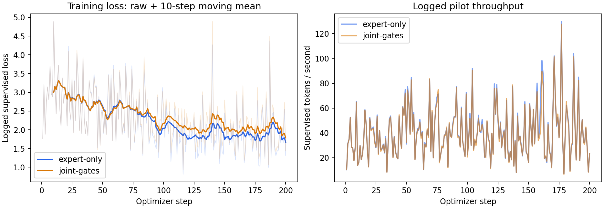

The faint traces are raw per-step training loss and the darker loss curves are
10-step moving means. These are training traces, not held-out learning curves.
Recorded throughput includes the measured step path and is not an end-to-end
service benchmark. Curves are derived from the two saved 200-row metric files;
no missing historical Stage 2 learning curve is fabricated.

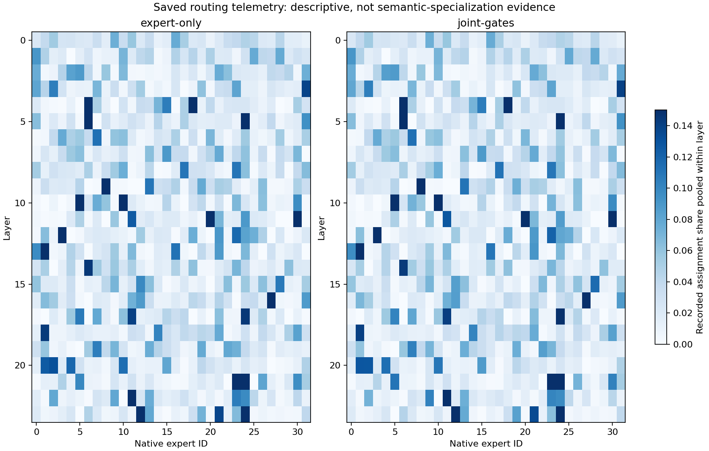

Each layer's counts pool the five recorded sources and normalize by its observed
assignments. Similar heatmaps do not establish equal quality, causal gate effects,
semantic expert labels or general load balancing. Raw telemetry and derivation
identities are listed in the evidence catalog.


The screenshot is historical real-model integration evidence. Its “ready” badge
is not a current readiness claim. The allocation subsequently stopped.

## Appendix C. Complete maintained source inventory

This enumerates maintained code, tests, configuration and launch assets inspected
for the report. Bulk data/weights, environments, caches and private archives are
deliberately outside this source inventory. File descriptions use module docstrings
or actual definitions; template presence does not mean a deployment was executed.
The accompanying JSON retains each full SHA256 and definition list.

### src — 22 files

| Path | Responsibility / definitions |
|---|---|
| `src/internal_moe/__init__.py` | Experimental token-routed MoE; independent of the external serving backend. |
| `src/internal_moe/layers.py` | Sparse token dispatch with differentiable gates and no token dropping. |
| `src/internal_moe/model.py` | Small causal language model for validating internal routing before upcycling. |
| `src/moe_router/__init__.py` | External mixture of experts application. |
| `src/moe_router/__main__.py` | Definitions:  |
| `src/moe_router/api.py` | Definitions: Query, HistoryMessage, StreamQuery, create_app |
| `src/moe_router/artifacts.py` | Definitions: sha256, inspect_safetensors |
| `src/moe_router/backend.py` | Definitions: BusyError, InputError, validate_artifacts, Backend |
| `src/moe_router/backends/__init__.py` | Separate external PEFT and private native engine profiles. |
| `src/moe_router/backends/internal_vllm.py` | Private native engine client with admission, disconnect cancellation, and SSE. |
| `src/moe_router/conversation.py` | Stateless, per-profile bounded history; never accept a client system role. |
| `src/moe_router/data_io.py` | JSONL uses physical newlines; Unicode separators inside JSON strings are data. |
| `src/moe_router/engine_auth.py` | vLLM ASGI middleware: require a server-only credential on every endpoint. |
| `src/moe_router/gptoss_expert_adapter.py` | Training-only low-rank updates to GPT-OSS's actual packed FFN experts. |
| `src/moe_router/gptoss_format.py` | Validated final-channel format for the pinned GPT-OSS candidate only. |
| `src/moe_router/native_data.py` | Shared native task instructions and assistant-only tokenization. |
| `src/moe_router/native_export.py` | Keep runtime-only positional buffers canonical when changing weight dtype. |
| `src/moe_router/router_metrics.py` | Metrics support known domains and partially labelled benign safety examples. |
| `src/moe_router/router_training.py` | Loss on complete prompt groups, matching inference's maximum safety window. |
| `src/moe_router/safety.py` | Safety routing takes priority over a manual domain request. |
| `src/moe_router/settings.py` | Definitions: load_local_env, Settings |
| `src/moe_router/validation_answers.py` | Conservative numeric answer extraction; never search for the reference in a reply. |

### web — 3 files

| Path | Responsibility / definitions |
|---|---|
| `web/app.js` | Browser event, request, history and stream behavior |
| `web/index.html` | Browser UI markup/styles |
| `web/style.css` | Browser UI markup/styles |

### training — 21 files

| Path | Responsibility / definitions |
|---|---|
| `training/apply_policy_review.py` | Apply completed, attributable reviews to training rows only, failing closed. |
| `training/audit_gptoss_targets.py` | Read-only CPU audit of exactly the supervised tokens in a pinned GPT-OSS run. |
| `training/calibrate_gptoss_adapter.py` | Validation-only shrinkage of a completed LoRA; original training and gates stay frozen. |
| `training/export_policy_review.py` | Export real training prompts for policy annotation; never invent training labels. |
| `training/gptoss_distributed.py` | Checkpoint and topology migration rules for the qualified native GPT-OSS trainer. |
| `training/launch_gptoss_distributed.py` | Forward Slurm's batch pre-timeout signal to the torchrun worker processes. |
| `training/prepare_native_data.py` | Prepare provenance-bound, answer-bearing native SFT data without generating targets. |
| `training/prepare_router_data.py` | Deduplicate before splitting; quarantine ambiguous labels rather than guessing. |
| `training/prepare_safety_data.py` | Build substantive router/SFT corpora from pinned annotated public datasets. |
| `training/prepare_safety_v2.py` | Add real annotated toxic prompts and human-written support to immutable v1. |
| `training/qualify_gptoss_ddp.py` | Bounded real-data one/two-GPU throughput and gradient-equivalence qualification. |
| `training/run_gptoss_checkpointed.py` | Operational checkpoint policy around the identity-pinned GPT-OSS trainer. |
| `training/run_gptoss_distributed.py` | Two-rank continuation of the identity-pinned trainer, with explicit topology lineage. |
| `training/run_gptoss_single_resume.py` | Single-GPU continuation of complete distributed checkpoints, preserving global batch. |
| `training/smoke_internal_moe.py` | CPU-sized reproducible mechanics check; synthetic tokens are not an LLM benchmark. |
| `training/train_expert.py` | Response-only QLoRA with audited filtering, dynamic padding, and resumable checkpoints. |
| `training/train_gptoss.py` | Real published-data attention LoRA, selected by validation answers rather than loss. |
| `training/train_gptoss_experts.py` | Actual expert/gate adaptation: real-data qualification then bounded pilot. |
| `training/train_native.py` | Fresh BF16 attention LoRA on the native MoE; experts/gates remain frozen. |
| `training/train_router.py` | Train a router on cleaned splits; choose checkpoints using validation only. |
| `training/train_safety_router.py` | Four-way router training with partial benign labels and validation calibration. |

### evaluation — 22 files

| Path | Responsibility / definitions |
|---|---|
| `evaluation/carry_native_reviews.py` | Carry existing assessments only for byte-identical prompts and answers. |
| `evaluation/check_native_browser.py` | Actual desktop/mobile native UI checks against the private allocated gateway. |
| `evaluation/compare_experts.py` | Produce a blind-review table; model generation alone is not a quality score. |
| `evaluation/compare_safety.py` | Blinded answer review on protected real prompts; no heuristic safety-score claim. |
| `evaluation/evaluate_native_product.py` | Real fixed-suite answer collection with declared automatic checks and blank reviews. |
| `evaluation/evaluate_router.py` | Definitions: metrics |
| `evaluation/finalize_safety_v2.py` | Collect completed experiment evidence; never promote unreviewed models. |
| `evaluation/load_native_product.py` | Allocated-node 500-request reliability run and optional two-hour sustained soak. |
| `evaluation/prepare_expert_confirmatory_suite.py` | Freeze a second comparison suite before Stage 3 pilot results are available. |
| `evaluation/prepare_gptoss_validation_review.py` | Prepare hash-bound semantic comparison sheets without changing training gates. |
| `evaluation/prepare_native_release_suite.py` | Freeze 500 real heldout tasks; safety intent/review scores remain unassessed. |
| `evaluation/prepare_native_safety_supplement.py` | Freeze separately reviewed real holdouts to close intent coverage gaps. |
| `evaluation/prepare_router_format_check.py` | Paired formatting diagnostic using real held-out prompts; never training data. |
| `evaluation/probe_native_operations.py` | Live gateway cancel/history/overload and private-engine cleanup probes. |
| `evaluation/smoke.py` | Real model smoke test; verifies router and selected expert, not answer quality. |
| `evaluation/smoke_safety_api.py` | Real-weight candidate API checks using protected prompts; no serving promotion. |
| `evaluation/summarize_gptoss_validation_review.py` | Full-denominator validation review coverage; never overrides training/export gates. |
| `evaluation/summarize_native_accuracy.py` | Keep attributed correctness intervals separate from unreviewed answer-key proxies. |
| `evaluation/summarize_native_agent_review.py` | Validate attributed review provenance and report coverage without imputing scores. |
| `evaluation/summarize_native_safety.py` | Combine frozen original and supplemental intent coverage without label shortcuts. |
| `evaluation/summarize_safety_review.py` | Summarize generation and explicitly entered review labels; never infer safety grades. |
| `evaluation/verify_live_safety_preview.py` | Verify the authenticated research preview with real held-out prompts and Chromium. |

### scripts — 110 files

| Path | Responsibility / definitions |
|---|---|
| `scripts/archive_generated_export.py` | Losslessly archive a failed generated export against a retained immutable export. |
| `scripts/build_comprehensive_diagrams.py` | Render the full project pipeline using Graphviz; no model execution. |
| `scripts/build_public_release.py` | Export curated source and aggregate evidence without private workspace files. |
| `scripts/check_native_live.py` | Check private engine auth on all paths and actual gateway SSE generation. |
| `scripts/check_native_quota.py` | Fail before expensive ICE work when the user's Lustre quota lacks headroom. |
| `scripts/check_public_release.py` | Check a curated release tree and write an attributable local validation record. |
| `scripts/collect_safety_v2.py` | Collect completed ICE candidates and private evaluation evidence with hashes. |
| `scripts/complete_comprehensive_report.py` | Add source/evidence appendices and derive figures from frozen saved artifacts. |
| `scripts/continue_gptoss_expert_pilots.py` | Bounded, fail-closed continuation from GPU qualification to two pilot jobs. |
| `scripts/demo_cpu.py` | Run an explicitly simulated, loopback-only UI/API demo without model weights. |
| `scripts/diagnose_gptoss_baseline.py` | Compare runtime parity on previously changed validation answers; never alter gates. |
| `scripts/download_base.py` | Definitions:  |
| `scripts/download_gpt_oss_candidate.py` | Stage the one approved alternative privately; verify every root weight LFS hash. |
| `scripts/download_native.py` | Download only the approved pinned OLMoE release into a private namespace. |
| `scripts/download_safety_data.py` | Download pinned public research data; save SHA-256 and attribution, never examples. |
| `scripts/evaluate_gptoss_development.py` | Bounded, resumable development diagnostics; never release acceptance. |
| `scripts/export_comprehensive_pdf.py` | Print the standalone report using installed Playwright Chromium, without inference. |
| `scripts/export_gptoss.py` | Bounded-memory FP32 attention merge plus exact standard-BF16 reload checks. |
| `scripts/export_gptoss_archived.py` | Run unchanged qualified BF16 export locally, then persist a verified archive. |
| `scripts/export_native.py` | Verify LoRA merging in FP32, then verify the BF16 export against itself on reload. |
| `scripts/finish_gptoss_research.py` | Bounded calibration and frozen comparisons; failed gates remain failed. |
| `scripts/freeze_external_release.py` | Verify and freeze references to every backed-up external checkpoint. |
| `scripts/ice_calibrate_gptoss.sbatch` | Site-specific Slurm template: calibrate gptoss |
| `scripts/ice_check_router_format.sbatch` | Site-specific Slurm template: check router format |
| `scripts/ice_compare_experts.sbatch` | Site-specific Slurm template: compare experts |
| `scripts/ice_compare_routers.sbatch` | Site-specific Slurm template: compare routers |
| `scripts/ice_compare_safety.sbatch` | Site-specific Slurm template: compare safety |
| `scripts/ice_compare_safety_v3.sbatch` | Site-specific Slurm template: compare safety v3 |
| `scripts/ice_continue_gptoss_expert_pilots.sbatch` | Site-specific Slurm template: continue gptoss expert pilots |
| `scripts/ice_diagnose_gptoss_baseline.sbatch` | Site-specific Slurm template: diagnose gptoss baseline |
| `scripts/ice_download_gpt_oss.sbatch` | Site-specific Slurm template: download gpt oss |
| `scripts/ice_download_native.sbatch` | Site-specific Slurm template: download native |
| `scripts/ice_evaluate.sbatch` | Site-specific Slurm template: evaluate |
| `scripts/ice_evaluate_external_native_suite.sbatch` | Site-specific Slurm template: evaluate external native suite |
| `scripts/ice_evaluate_safety_router.sbatch` | Site-specific Slurm template: evaluate safety router |
| `scripts/ice_evaluate_safety_router_v3.sbatch` | Site-specific Slurm template: evaluate safety router v3 |
| `scripts/ice_evaluate_safety_supplement.sbatch` | Site-specific Slurm template: evaluate safety supplement |
| `scripts/ice_evaluate_safety_v2.sbatch` | Site-specific Slurm template: evaluate safety v2 |
| `scripts/ice_export_gptoss.sbatch` | Site-specific Slurm template: export gptoss |
| `scripts/ice_export_gptoss_archived.sbatch` | Site-specific Slurm template: export gptoss archived |
| `scripts/ice_export_native.sbatch` | Site-specific Slurm template: export native |
| `scripts/ice_finalize_safety_v2.sbatch` | Site-specific Slurm template: finalize safety v2 |
| `scripts/ice_finish_gptoss_research.sbatch` | Site-specific Slurm template: finish gptoss research |
| `scripts/ice_gptoss_development.sbatch` | Site-specific Slurm template: gptoss development |
| `scripts/ice_gptoss_recovery_batch.sbatch` | Site-specific Slurm template: gptoss recovery batch |
| `scripts/ice_internal_smoke.sbatch` | Site-specific Slurm template: internal smoke |
| `scripts/ice_native_cpu_checks.sbatch` | Site-specific Slurm template: native cpu checks |
| `scripts/ice_pin_native_serve.sbatch` | Site-specific Slurm template: pin native serve |
| `scripts/ice_probe_native_cache.sbatch` | Site-specific Slurm template: probe native cache |
| `scripts/ice_profile_native.sbatch` | Site-specific Slurm template: profile native |
| `scripts/ice_qualify_gptoss.sbatch` | Site-specific Slurm template: qualify gptoss |
| `scripts/ice_qualify_gptoss_ddp.sbatch` | Site-specific Slurm template: qualify gptoss ddp |
| `scripts/ice_qualify_gptoss_engine.sbatch` | Site-specific Slurm template: qualify gptoss engine |
| `scripts/ice_qualify_native.sbatch` | Site-specific Slurm template: qualify native |
| `scripts/ice_recover_large.sbatch` | Site-specific Slurm template: recover large |
| `scripts/ice_scratch_environment.sh` | Shell environment/startup utility |
| `scripts/ice_serve.sbatch` | Site-specific Slurm template: serve |
| `scripts/ice_serve_gptoss.sbatch` | Site-specific Slurm template: serve gptoss |
| `scripts/ice_serve_gptoss_archived.sbatch` | Site-specific Slurm template: serve gptoss archived |
| `scripts/ice_serve_native.sbatch` | Site-specific Slurm template: serve native |
| `scripts/ice_serve_safety_preview.sbatch` | Site-specific Slurm template: serve safety preview |
| `scripts/ice_setup_gptoss_train.sbatch` | Site-specific Slurm template: setup gptoss train |
| `scripts/ice_setup_native_browser.sbatch` | Site-specific Slurm template: setup native browser |
| `scripts/ice_setup_native_serve.sbatch` | Site-specific Slurm template: setup native serve |
| `scripts/ice_smoke.sbatch` | Site-specific Slurm template: smoke |
| `scripts/ice_smoke_safety_api.sbatch` | Site-specific Slurm template: smoke safety api |
| `scripts/ice_smoke_safety_v3.sbatch` | Site-specific Slurm template: smoke safety v3 |
| `scripts/ice_summarize_gptoss_completion.sbatch` | Site-specific Slurm template: summarize gptoss completion |
| `scripts/ice_train_gptoss.sbatch` | Site-specific Slurm template: train gptoss |
| `scripts/ice_train_gptoss_ddp.sbatch` | Site-specific Slurm template: train gptoss ddp |
| `scripts/ice_train_gptoss_experts.sbatch` | Site-specific Slurm template: train gptoss experts |
| `scripts/ice_train_gptoss_single_resume.sbatch` | Site-specific Slurm template: train gptoss single resume |
| `scripts/ice_train_native.sbatch` | Site-specific Slurm template: train native |
| `scripts/ice_train_safety_expert.sbatch` | Site-specific Slurm template: train safety expert |
| `scripts/ice_train_safety_expert_v3.sbatch` | Site-specific Slurm template: train safety expert v3 |
| `scripts/ice_train_safety_router.sbatch` | Site-specific Slurm template: train safety router |
| `scripts/ice_train_safety_router_large.sbatch` | Site-specific Slurm template: train safety router large |
| `scripts/ice_train_safety_router_v2.sbatch` | Site-specific Slurm template: train safety router v2 |
| `scripts/ice_train_safety_router_v3.sbatch` | Site-specific Slurm template: train safety router v3 |
| `scripts/ice_verify_native_download.sbatch` | Site-specific Slurm template: verify native download |
| `scripts/integrate_handoff.py` | Integrate verified transfer with per-file backups; never touch runtime/secrets/weights. |
| `scripts/native_model_archive.py` | Persist exact HF exports compressed; restore verified standard files on local disk. |
| `scripts/native_service.py` | Own private engine/gateway children and verify restart plus external rollback. |
| `scripts/native_submission_env.py` | Prevent an interactive allocation's device/rank mapping leaking into a new job. |
| `scripts/package_handoff.py` | Create a private ICE continuation bundle, excluding credentials and weights. |
| `scripts/package_source.py` | Build a reproducible source-only archive; models, environments and secrets stay local. |
| `scripts/plot_release_results.py` | Plot frozen aggregate proxies; these figures do not imply reviewed accuracy. |
| `scripts/prepare_artifacts.py` | Copy audited router metadata and attach existing adapters without changing originals. |
| `scripts/prepare_safety_preview.py` | Create a separate, versioned research bundle without promoting candidates. |
| `scripts/probe_native_cache.py` | Investigate BF16 cache differences against FP32 and multi-token greedy checks. |
| `scripts/qualify_gptoss_candidate.py` | Allocated-GPU validation, cache and real-train-row resource probe for one alternative. |
| `scripts/qualify_gptoss_engine.py` | Private original-MXFP4 vLLM qualification; BF16 tuned export remains a later gate. |
| `scripts/qualify_gptoss_expert_export.py` | Qualify a real Stage 3 checkpoint as a standard node-local HF model. |
| `scripts/qualify_native.py` | Allocated-GPU native BF16/cache/real-answer qualification, never a toy model. |
| `scripts/qualify_native_precision.py` | Bind raw cache diagnostics to an explicit, precision-aware adaptation gate. |
| `scripts/reconcile_native_deployment.py` | Correct an expired deployment record from Slurm evidence; never stop processes. |
| `scripts/record_training_launch.py` | Capture exact executed recipes/source/data hashes before GPU optimization. |
| `scripts/recover_large_router.py` | Strictly recover per-tensor chunks into a NEW standard checkpoint directory. |
| `scripts/render_comprehensive_report.py` | Render the full Markdown report as standalone HTML (Markdown==3.8.2). |
| `scripts/render_research_report.py` | Build a standalone HTML report from public Markdown and aggregate figures. |
| `scripts/restart_safety_preview.py` | Restart the private ICE research demo through an authenticated SSH master. |
| `scripts/retire_archived_failed_export.py` | One-time retirement of only the four restored, failed OLMoE generated shards. |
| `scripts/start.sh` | Shell environment/startup utility |
| `scripts/start_native_gateway.py` | Start the authenticated native gateway; never print credentials. |
| `scripts/summarize_gptoss_completion.py` | Verify frozen comparisons and generate an honest research completion report. |
| `scripts/sync_native_source.py` | Backed-up source rollout plus additive native namespaces; preserve external assets. |
| `scripts/verify_bundle.py` | Definitions:  |
| `scripts/verify_external_ice.py` | Bind the frozen external release to actual ICE paths without moving weights. |
| `scripts/verify_handoff.py` | Verify an extracted private continuation bundle using only Python stdlib. |
| `scripts/verify_native_download.py` | Verify pinned upstream LFS SHA-256, sizes, and safetensors headers. |

### configs — 13 files

| Path | Responsibility / definitions |
|---|---|
| `configs/internal/gptoss-experts-v2-native-eval.json` | Configuration or deployment/template asset |
| `configs/internal/gptoss-experts-v2.json` | Configuration or deployment/template asset |
| `configs/internal/gptoss-training-constraints.txt` | Configuration or deployment/template asset |
| `configs/internal/gptoss-v1-lr2e-6.json` | Configuration or deployment/template asset |
| `configs/internal/gptoss-v1.json` | Configuration or deployment/template asset |
| `configs/internal/native-v1.json` | Configuration or deployment/template asset |
| `configs/internal/native_safety_supplement.json` | Configuration or deployment/template asset |
| `configs/model_manifest.json` | Configuration or deployment/template asset |
| `configs/model_manifest_safety_preview.json` | Configuration or deployment/template asset |
| `configs/native_sources.json` | Configuration or deployment/template asset |
| `configs/runtime.example.json` | Configuration or deployment/template asset |
| `configs/safety_sources.json` | Configuration or deployment/template asset |
| `configs/safety_sources_v2.json` | Configuration or deployment/template asset |

### tests — 39 files

| Path | Responsibility / definitions |
|---|---|
| `tests/test_api.py` | Tests: ServiceDouble, settings, test_restricted_chat_and_compatibility, test_full_queue_is_retryable |
| `tests/test_backend.py` | Tests: test_adapter_selection_and_generation_are_serialized, test_queue_timeout_releases_capacity, test_checkpoint_label_order_is_explicit |
| `tests/test_carry_native_reviews.py` | Tests: records, test_exact_reuse_preserves_original_attribution_and_marks_not_independent, test_any_changed_assessment_input_prevents_reuse, test_stale_source_review_rejected |
| `tests/test_cpu_demo.py` | Tests: test_cpu_demo_is_authenticated_and_explicitly_simulated |
| `tests/test_data.py` | Tests: test_no_split_overlap_and_conflicts_quarantined |
| `tests/test_expert_confirmatory_suite.py` | Tests: test_selection_excludes_normalized_prior_and_cross_group_duplicates, test_selection_is_order_independent |
| `tests/test_expert_pilot_controller.py` | Controller proves readiness gates and crash-safe bounded scheduler behavior. |
| `tests/test_generated_export_archive.py` | Tests: GeneratedArchiveTest |
| `tests/test_gptoss_calibration.py` | A calibrated adapter retains a real learned update and correct projection algebra. |
| `tests/test_gptoss_completion_report.py` | Tests: test_completed_collection_requires_matched_inputs_and_selected_checkpoint |
| `tests/test_gptoss_ddp_qualification.py` | Check actual DDP averaging for unequal response lengths before GPU qualification. |
| `tests/test_gptoss_development.py` | Ensure matched development controls and frozen-date export reuse. |
| `tests/test_gptoss_distributed_resume.py` | Real CPU Trainer transition: unchanged global batch, complete rank RNG, safe resume. |
| `tests/test_gptoss_expert_adapter.py` | Real miniature GPT-OSS architecture: native parity, training and standard export. |
| `tests/test_gptoss_expert_export.py` | Export gates detect numeric divergence and verify native cached decoding. |
| `tests/test_gptoss_expert_training.py` | Checkpoint correctness and deterministic sample cursor, independent of GPUs. |
| `tests/test_gptoss_finish.py` | Development selection must not turn failed exports into accepted candidates. |
| `tests/test_gptoss_launcher_signal.py` | Tests: test_checkpoint_signal_reaches_only_launchers_direct_worker |
| `tests/test_gptoss_phase_archival.py` | Tests: test_interim_answers_status_and_adapter_are_preserved_before_resume |
| `tests/test_gptoss_selection_date.py` | Tests: test_date_is_explicit_in_memory_and_original_template_value_unchanged, test_invalid_dates_are_rejected |
| `tests/test_gptoss_training.py` | Protect final-only supervision/output and validation quality selection. |
| `tests/test_gptoss_validation_review.py` | Reject comparisons with changed questions/answers instead of certifying proxies. |
| `tests/test_internal_moe.py` | Tests: test_upcycling_preserves_dense_output_and_dispatch, test_gate_and_selected_experts_receive_gradients, test_decoder_cannot_read_future_tokens, test_padding_excluded_from_router_lo |
| `tests/test_native_accuracy.py` | Incomplete or uncertain assessments must not become exact passing accuracy. |
| `tests/test_native_data.py` | Tests: row, test_protected_holdout_excludes_connected_training_context, test_publisher_conflicts_quarantine_whole_conversation, test_targets_conflict_and_duplicates_are_not_silently_sel |
| `tests/test_native_export.py` | Regression for the real OLMoE buffer mismatch invisible to weight hashes. |
| `tests/test_native_load_format.py` | Operational input counts must match the actual gateway template and reservation. |
| `tests/test_native_model_archive.py` | Tests: NativeArchiveTest |
| `tests/test_native_operator.py` | Exercise child startup ordering, readiness failures and clean signal exit. |
| `tests/test_native_quota.py` | Tests: test_overquota_marker_is_not_mistaken_for_available_filesystem_space, test_both_storage_and_file_limits_are_required, test_failed_checkpoint_is_quarantined_without_touching_previ |
| `tests/test_native_service.py` | Tests: Tokenizer, native_settings, transport, test_native_auth_contract_history_and_unavailable_profiles |
| `tests/test_native_submission_env.py` | Tests: test_new_job_receives_its_own_gpu_rank_and_slurm_mapping |
| `tests/test_operational_checkpoint.py` | Wall-clock saves must preserve the Trainer's existing evaluation decisions. |
| `tests/test_router_checkpointing.py` | Real DeBERTa backward regression, run in the recovered training environment. |
| `tests/test_safety.py` | Tests: test_safety_has_priority_over_requested_math_and_base, test_benign_manual_override_and_legacy_router_compatibility, test_four_expert_router_cannot_start_without_safety_weights, t |
| `tests/test_safety_improvements.py` | Tests: test_calibrated_threshold_is_not_bypassed_by_top_safety_class, test_late_safety_evidence_reduces_group_loss_and_receives_gradient, test_benign_long_prompt_penalizes_safety_in_any |
| `tests/test_safety_review.py` | Tests: test_unreviewed_responses_do_not_receive_invented_zero_harm_scores, test_benign_source_unsafe_labels_do_not_dilute_reviewed_harmful_compliance |
| `tests/test_source_release.py` | Tests: packager, test_source_archive_excludes_private_and_generated_files, test_source_archive_rejects_embedded_credentials |
| `tests/test_validation_answers.py` | Tests: test_explicit_answer_is_not_replaced_by_later_context_numbers, test_does_not_accept_reference_mentions_or_earlier_bold_intermediate_values |

### deploy — 3 files

| Path | Responsibility / definitions |
|---|---|
| `deploy/Dockerfile` | Configuration or deployment/template asset |
| `deploy/aws/template.yaml` | Configuration or deployment/template asset |
| `deploy/compose.yaml` | Configuration or deployment/template asset |

## Appendix D. Evidence catalog and original identities

References [E01]–[E40] identify the preserved records actually read for this report.
Paths are relative to the research workspace unless prefixed `external-workspace/`,
which denotes the preserved external application checkout. Raw artifacts may remain
private or access-restricted; hashes are not a claim that those files ship with
public source. The PDF/HTML is self-contained for interpretation of its results.

| ID | Record | Preserved source path | SHA256 prefix |
|---|---|---|---|
| E01 | External preservation inventory | `audit/releases/external-v1-ice.json` | `f573b81c8c453e79` |
| E02 | Latest external/source preservation verification | `audit/completion-batch-20261021/preserved-external-artifacts-verified-20261022.json` | `8a3637a46d4cd981` |
| E03 | External safety extension, v3 routing and comparison ledger | `external-workspace/audit/safety_improvement_v2.json` | `70030d2063d2ecfa` |
| E04 | Native prepared-data manifest | `data/native/prepared/v1/manifest.json` | `b0c4d9671b68d013` |
| E05 | Rejected OLMoE candidate outcome | `audit/native/olmoe-v1-candidate-outcome.json` | `f3d145f8c2a977e0` |
| E06 | One/two-GPU numerical/scaling comparison | `outputs/internal/native/gptoss/ddp-qualification-6329565/comparison.json` | `cc7af7e1a36a09ab` |
| E07 | Stage 2 archive restoration | `artifacts/internal/native/gptoss/v1/archive-20261018-r4-scored-calibrated/archive-verification.json` | `a2152576c1982abf` |
| E08 | Four-trial calibration and selected Stage 3 archive | `audit/completion-batch-20261021/verified-calibration-results.json` | `0dc13a23d682b7b3` |
| E09 | Real native expert qualification | `outputs/internal/native/gptoss/qualify-20261020-native-eval-v2/report.json` | `ddc4902404b7c41e` |
| E10 | Frozen completion plan and selection identity | `audit/completion-batch-20261021/plan.json` | `89f5371a54f4dc1a` |
| E11 | Expert-only routing telemetry | `outputs/internal/native/gptoss/moe-e2-f36368c989-expert-only/expert-usage.json` | `5a812ca707297341` |
| E12 | Joint-gate routing telemetry | `outputs/internal/native/gptoss/moe-e2-f36368c989-joint-gates/expert-usage.json` | `a776d1d6dbdbc8ad` |
| E13 | Earlier 526-answer attributed assessment | `audit/native/gptoss-r4-answer-assessment-20261019.json` | `b2d5491c2e363b66` |
| E14 | Final 1,500-answer verified comparison | `outputs/internal/evaluation/finish-20261021/FINAL_RESEARCH_RESULTS.json` | `30b45b992b1aff0a` |
| E15 | Post-hoc qualitative sample manifest | `audit/completion-batch-20261021/qualitative-review-sample.json` | `96882d472944c2d1` |
| E16 | Historical passing cold start | `audit/native/archive-cold-start-6403909.json` | `251dae5abd893205` |
| E17 | Historical full Stage 2 soak | `audit/native/load-soak-6403909/summary.json` | `d4b08c1df5745b34` |
| E18 | Historical native restart and external rollback | `audit/native/recovery-6403909.json` | `5d9ed3c66e25ffb3` |
| E19 | Latest real engine/gateway checks | `audit/native/live-6479705.json` | `5d70597418eb9196` |
| E20 | Latest real cancellation/history/overload checks | `audit/native/live-6479705-operations.json` | `c27a422ea556d370` |
| E21 | Latest desktop/mobile browser checks | `audit/native/browser-6479705/report.json` | `c2fb6e30ea24e2e1` |
| E22 | Latest failed cold-start gate | `audit/native/archive-cold-start-6479705.json` | `ceff61a9387ce8e7` |
| E23 | Latest stopped deployment record | `audit/native/deployment-6479705.json` | `179a3880a70c15a5` |
| E24 | Home/scratch cleanup verification | `audit/completion-batch-20261021/final-storage-verification-20261022.json` | `d8530453de1434ff` |
| E25 | Storage relocation and cleanup narrative | `docs/STORAGE_CLEANUP_2026-10-21.md` | `26a1a2db1eb672f1` |
| E26 | Release-tree CPU test results | `audit/release-20261022/release-tests.xml` | `1dbd9c05bd69d7e9` |
| E27 | Fresh local clone quick-start test results | `audit/release-20261022/fresh-clone-tests.xml` | `dde0a0228c21ecd9` |
| E28 | Preserved GPT-OSS inference overlay inventory | `audit/completion-batch-20261021/inference-environment-supplement-20261022.json` | `48691ba5a9ddeec4` |
| E29 | Parent qualitative review | `audit/completion-batch-20261021/parent-qualitative-review-20261022.json` | `649c7d25aa391b4c` |
| E30 | Candidate qualitative review | `audit/completion-batch-20261021/candidate-qualitative-review-20261022.json` | `594439dec22616e5` |
| E31 | Original immutable final research report | `docs/FINAL_RESEARCH_REPORT_2026-10-21.md` | `b1083c842165f231` |
| E32 | Expert-only completed pilot | `outputs/internal/native/gptoss/moe-e2-f36368c989-expert-only/report.json` | `c7c36295a901b65a` |
| E33 | Joint-gate completed pilot | `outputs/internal/native/gptoss/moe-e2-f36368c989-joint-gates/report.json` | `a549d626df18b84d` |
| E34 | Stage 2 training and calibrated provenance | `outputs/internal/native/gptoss/20261018-r4-scored-calibrated/sft/provenance.json` | `fb5311913888b081` |
| E35 | Final independent artifact audit | `audit/completion-batch-20261021/FINAL_COMPLETION_AUDIT_20261022.json` | `e75342fbf2ab2b88` |
| E36 | Actual joint-gate pilot configuration and environment | `outputs/internal/native/gptoss/moe-e2-f36368c989-joint-gates/metadata-6429777.json` | `d1f8d99053a98bea` |
| E37 | Pinned native data sources | `configs/native_sources.json` | `763dd022d17b6569` |
| E38 | Pinned original safety data sources | `configs/safety_sources.json` | `17a1c66abe7f04c3` |
| E39 | Pinned support/toxicity extension sources | `configs/safety_sources_v2.json` | `5660130ef2b4d3aa` |
| E40 | Historical external safety experiment report | `docs/SAFETY_RESULTS.md` | `acf20f188979120a` |

Full 64-character digests and byte counts are in `evidence-catalog.json` beside the
rendered report. `verified-report-metrics.json` contains the checked answer hashes,
cold-start outcomes and descriptive telemetry summaries. DOT/SVG/PNG figure sources
are supplied in `figures/`; diagrams represent implemented paths and declared
gates, not unsupported product capabilities.

## Appendix E. Reproduction and reporting boundaries

The source CPU quick start is `python -m pip install -e '.[dev]'` followed by the
targeted API/demo/data/packaging tests. The release also provides an exact CPU-demo
dependency lock. Real GPU inference requires the matching upstream base,
compatible tokenizer/adapters, separate model access, a qualified environment and
an actual allocation. Full past research requires identity-matched prepared data
and archived artifacts; a source-only clone does not supply them.

Read-only status verification uses `squeue`, `sacct`, exact job-bound reports and
artifact checksums. Do not execute historical training/export commands merely
because they are documented: experimentation is frozen. To rebuild this report,
run `scripts/build_comprehensive_diagrams.py` and
`scripts/complete_comprehensive_report.py`, then render the Markdown with the
report renderer. Rebuilding uses saved evidence and creates no model experiment.

Some underlying metrics were generated by preexisting imperfect automatic scorers;
the report preserves their limitations and versions. It does not fabricate human
labels, silently relax thresholds, merge incompatible cohorts or convert a clean
scheduler exit into a quality pass. Updated publication/deployment evidence should
be appended with a new verification timestamp, preserving prior failed records.

## Appendix F. Documentation and repository entry-point index

Older documentation is retained for provenance and may contain historical queue
states or superseded plans. This comprehensive report and job-bound artifacts
govern current status. Original reports are not silently rewritten to hide failed
experiments. The following index locates the rest of the project documentation.

| Path | Document / entry point |
|---|---|
| `docs/ARCHITECTURE.md` | Architecture |
| `docs/DEPLOYMENT.md` | Restricted deployment with zero AWS spend |
| `docs/FINAL_RESEARCH_REPORT_2026-10-21.md` | Stage 2–3 final research report |
| `docs/GPTOSS_RECOVERY_2026-10-18.md` | GPT-OSS regression recovery — October 18, 2026 |
| `docs/INTERNAL_MOE.md` | Internal MoE development |
| `docs/INTERNAL_MOE_PRODUCT_PROPOSAL.md` | External-to-internal MoE: deployable product proposal |
| `docs/INTERNAL_PRODUCT_RUNBOOK.md` | Native internal MoE on ICE |
| `docs/MOE_DUAL_TRACK_ROADMAP.md` | External and internal MoE: staged product roadmap |
| `docs/NATIVE_GPTOSS_EXECUTION.md` | Native alternative execution — October 17, 2026 |
| `docs/NATIVE_REVIEW_RUBRIC.md` | Native v1 restricted research answer review |
| `docs/OPERATIONS.md` | ICE operation |
| `docs/PROJECT_RELEASE_PLAN_2026-10-22.md` | Project completion, deployment and publication plan |
| `docs/QUALITY.md` | Model quality evidence |
| `docs/RELEASE_PROGRESS_2026-10-22.md` | Release progress — October 22, 2026 |
| `docs/REMOTE_SESSION_HANDOFF.md` | ICE continuation handoff |
| `docs/RESEARCH_RELEASE.md` | Restricted research release |
| `docs/RESULTS.md` | Verified results and release scope |
| `docs/SAFETY_EXPERT.md` | Fourth expert: safety alignment |
| `docs/SAFETY_IMPROVEMENT_V2.md` | Safety improvement experiment v2 |
| `docs/SAFETY_RESULTS.md` | Safety experiment results |
| `docs/SAFETY_REVIEW_GUIDE.md` | Next steps for safety quality |
| `docs/STAGE23_COMPLETION_2026-10-21.md` | Stage 2–3 bounded completion batch — October 21, 2026 |
| `docs/STAGE23_RUNS_2026-10-20.md` | Stage2 and Stage3 queued experiments — October20,2026 |
| `docs/STAGE2_ACCEPTANCE_2026-10-19.md` | Stage 2 acceptance evidence, October 19, 2026 |
| `docs/STATUS.md` | Implementation status |
| `docs/STORAGE_CLEANUP_2026-10-21.md` | Home quota recovery — October 21, 2026 |
| `docs/models/SAFETY_LORA_V2.md` | SAFETY LoRA v2 model card |
| `docs/models/SAFETY_LORA_V3.md` | SAFETY LoRA v3 model card |
| `docs/models/SAFETY_ROUTER_V3.md` | SAFETY router v3 model card |
| `README.md` | External MoE Router |
| `README_STAGE_1_2.md` | Dual-Profile Mixture-of-Experts: Recovery, Adaptation, and Serving |
| `AGENTS.md` | Georgia Tech ICE / Slurm Research Compute Instructions |
| `PROJECT_COMPLETION_PLAN.md` | External MoE recovery and completion plan |
| `LICENSE` | LICENSE |
| `pyproject.toml` | pyproject.toml |
| `requirements-api.lock` | requirements-api.lock |
| `.gitignore` | .gitignore |
| `.env.example` | Artifact root must contain base/, router/, math_expert/, science_expert/, general_expert/. |
| `.github/workflows/checks.yml` | checks.yml |

## Appendix G. Requirement-to-evidence traceability

| Requirement | Implementation/evidence | Current decision |
|---|---|---|
| Preserve existing specialists | Frozen weight inventory and original source archive, E01–E02 | Verified |
| Correct request routing | Named adapter selection, checkpoint label metadata and lock | Implemented and integrated |
| Add support/safety coverage | Published-data extension and v3 ledger, E03 | Integration complete; routing gates failed |
| Avoid fabricated data/reviews | Source manifests, review importer and blank masked forms | No synthetic native training examples; human review pending |
| Prevent exact project split leakage | Grouped source preparation and protected keys, E04 | Checks passed; semantic contamination unknown |
| Train native model reproducibly | Provenance/config/checkpoint identity, E34 | Stage 2 completed; quality failed |
| Justify multi-GPU work | Fixed-batch numerical/scaling comparison, E06 | Qualified only within measured benchmark |
| Export actual learned updates | Projection/frozen-state/reload probes and archives, E07–E10 | Selected research exports qualified |
| Train actual FFN experts/gates | Qualified resume, changed-state and pilot reports, E09/E32/E33 | Both pilots completed |
| Compare selected model fairly | Frozen protocol, 500 paired input hashes, E14 | No demonstrated held-out proxy gain |
| Operate private app reliably | API/browser/load/recovery, E16–E23 | Historical full pass; latest cold start failed |
| Keep resources/storage bounded | QoS policy, scratch helper, cleanup proof, E24–E25 | Implemented policy; quotas require ongoing checks |
| Provide reproducible public source | Export manifests and CPU/fresh-clone checks, E26–E27 | Local candidate prepared; remote publication pending |
| Establish independent quality | Masked review sheet and reviewer protocol | Pending; not replaced by AI assessments |
| Accept production deployment | All relevant integrity, operations, quality and review gates | False; research scope only |

## Appendix H. Full declared configurations and pinned source registry

These are the saved configuration objects, not newly chosen hyperparameters.
Stage 2 provenance also records its post-training calibration. Stage 3's runtime
variant flag chooses expert-only versus joint gates while sharing the configuration
below. Paths refer to the prepared research workspace, whose required artifacts
are not included by a source-only clone. [E34, E36]

### Stage 2 recorded configuration

```json
{
  "profile": "native-internal-v1",
  "candidate_release": "native-internal-v1-gptoss-r4-scored-calibrated",
  "repository": "openai/gpt-oss-20b",
  "revision": "6cee5e81ee83917806bbde320786a8fb61efebee",
  "base": "artifacts/internal/native/candidates/gpt-oss-20b/base",
  "data": "data/native/prepared/v1",
  "max_length": 1024,
  "context_limit": 2048,
  "output_limit": 256,
  "rank": 8,
  "alpha": 16,
  "target_modules": [
    "q_proj",
    "k_proj",
    "v_proj",
    "o_proj"
  ],
  "experts_and_gates_frozen": true,
  "epochs": 1,
  "gradient_accumulation": 16,
  "learning_rate": 2e-06,
  "eval_steps": 300,
  "answer_validation_per_source": 64,
  "seed": 42,
  "production_accepted": false,
  "access": "restricted_noncommercial_research"
}
```

### Stage 3 recorded configuration

```json
{
  "profile": "native-internal-v2-expert-pilot",
  "parent_release": "native-internal-v1-gptoss-r4-scored-calibrated",
  "archive": "artifacts/internal/native/gptoss/v1/archive-20261018-r4-scored-calibrated",
  "tokenizer": "artifacts/internal/native/candidates/gpt-oss-20b/base",
  "data": "data/native/prepared/v1",
  "rank": 2,
  "alpha": 2.0,
  "max_length": 512,
  "train_per_source": 200,
  "validation_per_source": 16,
  "effective_batch": 2,
  "max_steps": 200,
  "expert_learning_rate": 1e-05,
  "gate_learning_rate": 1e-06,
  "gate_warmup_steps": 20,
  "qualification_gate_warmup_steps": 2,
  "eval_steps": 50,
  "checkpoint_seconds": 1200,
  "seed": 42,
  "production_accepted": false,
  "answer_quality_accepted": false,
  "access": "restricted_noncommercial_research",
  "question": "Can actual FFN low-rank updates followed by native gate updates improve fixed validation response NLL over the preserved Stage 2 candidate without changing its architecture?",
  "scope": "Qualification and bounded pilot only; independent generated-answer and merge/reload checks required for Stage 3 acceptance",
  "template_date": "2026-10-19",
  "change_note": "Preserve original tokenized date while correcting native CUDA evaluation arithmetic; datasets, seeds, rank and optimizer settings unchanged."
}
```

### Actual pilot environment

The joint-gate metadata records CUDA 12.8 and the following
package versions. A CUDA version recorded by Torch is not a claim that every
system driver/toolkit component has the same version.

| Package | Recorded version |
|---|---|
| torch | 2.8.0 |
| transformers | 4.57.5 |
| peft | 0.18.1 |

### Pinned source identities

These source registries distinguish upstream revision identity from a locally
prepared split hash. Recorded terms are provenance, not blanket redistribution
permission. The source files and inherited manifests must also pass integrity
checks before reproducing the original preparation. [E37–E39]

| Registry / source | Repository or provider | Pinned revision | Recorded terms |
|---|---|---|---|
| native_sources.json / gsm8k | openai/grade-school-math | `3101c7d5072418e28b9008a6636bde82a006892c` | MIT |
| native_sources.json / sciq | allenai/sciq | `2c94ad3e1aafab77146f384e23536f97a4849815` | CC-BY-NC-3.0 |
| native_sources.json / dolly | databricks/databricks-dolly-15k | `bdd27f4d94b9c1f951818a7da7fd7aeea5dbff1a` | CC-BY-SA-3.0 |
| safety_sources.json / aegis | nvidia/Aegis-AI-Content-Safety-Dataset-2.0 | `d86bb8bedff51d25ac834ab7838f1cc61acb7a2c` | CC-BY-4.0 |
| safety_sources.json / pku | PKU-Alignment/PKU-SafeRLHF | `9421ffafec3fa40a1f1a7d567b4d525079477ecb` | CC-BY-NC-4.0 |
| safety_sources.json / do_not_answer | LibrAI/do-not-answer | `74e74f2e4507ef256fe536f78a776f4a1ff67955` | Apache-2.0 |
| safety_sources_v2.json / esconv | thu-coai/Emotional-Support-Conversation | `f262d062ad74cb39b17ea476facc81568ddcba24` | Academic research only; copyright CoAI Group, Tsinghua University |
| safety_sources_v2.json / toxicchat | lmsys/toxic-chat | `29df8e4dba60e1f4af4b4075c0705c5b313548a8` | CC-BY-NC-4.0 |
